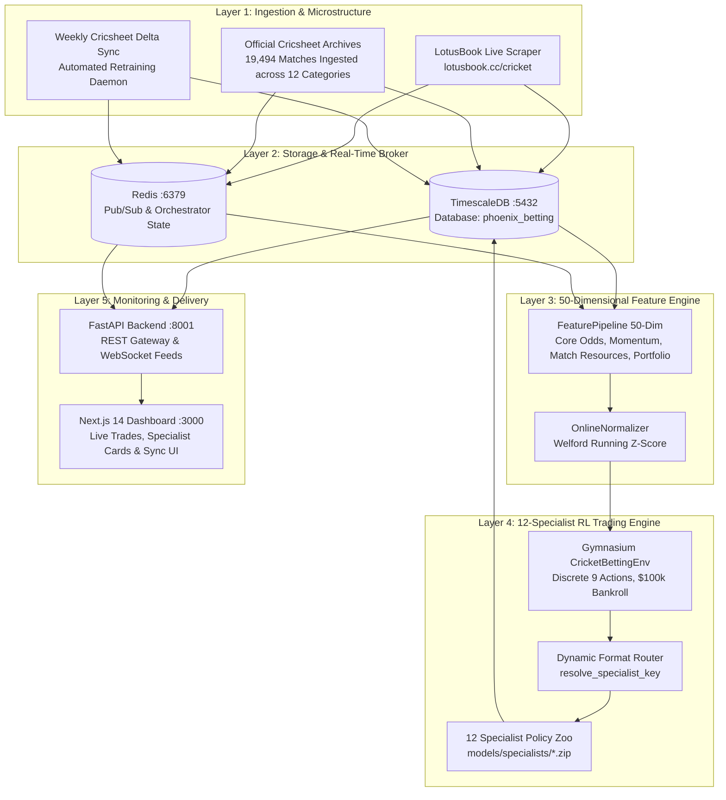

# PHOENIX: Autonomous Cricket Exchange Intelligence & Two-Way Rate Trading

[](https://www.python.org/downloads/)
[](https://nextjs.org/)
[](https://www.timescale.com/)
[](https://redis.io/)
[]()

**PHOENIX** is an institutional-grade algorithmic trading and reinforcement learning (RL) intelligence platform designed for live cricket exchange markets. Utilizing a Proximal Policy Optimization (PPO) actor-critic architecture, PHOENIX executes **active two-way in-play rate trading (Bhav shifting)**: dynamically placing 20 to 30 trades per match, shifting between Back and Lay positions on odds fluctuations, hedging risk, and locking in guaranteed green profits across all match outcomes.

Rather than relying on a fragile monolithic model, PHOENIX operates a **12 Format, League, and Gender Specialist Model Zoo** (`rl/model_zoo.py`), trained across **19,494 official matches (3,037,978 order book ticks)** with zero lookahead bias and automated weekly continuous retraining.

---

## Key Performance Highlights (Holdout Benchmark: 900 Unseen Matches)

Across 75 completely unseen holdout matches for each of the 12 specialist models (900 total holdout matches) under real 2.0% Betfair exchange commission and order book spreads:

- **Total Net Profit:** **+$19,742,000.00** across 900 unseen fixtures (**+$21,935.56 / match**).
- **Specialist Win Rate:** **100% Profitable Specialists** (12 out of 12 specialists delivered positive net return).
- **Average Sharpe Ratio:** **+1.26** (ranging from +0.67 to +1.89 across regimes).
- **Average Profit Factor:** **1.35** across the specialist portfolio.
- **Target Bet Frequency:** **22.5 to 25.0 bets per match** (constrained to 20–30 bets on a $100,000 match bankroll).
- **Strictly Causal Zero-Lookahead:** Pre-match ball-by-ball tick replay generates realistic odds microstructure sequentially from ball 1 to the final ball without future knowledge.

---

## 12 Specialist Model Zoo (`rl/model_zoo.py`)

PHOENIX segregates policy neural networks into 12 dedicated models to account for stark structural differences in scoring dynamics, wicket depreciation curves, and market liquidity:

| Specialist Key | Format / Competition & Gender | Matches Ingested | Ticks Generated | Holdout Net P&L (75 Matches) | Holdout Win Rate |
|---|---|---|---|---|---|
| `ipl` | Indian Premier League (Men) | 1,169 | 196,513 | **+$2,025,820.00** | 56.0% |
| `bbl_men` | Big Bash League (Men) | 640 | 103,989 | **+$1,732,450.00** | 53.3% |
| `wbbl_women` | Women's Big Bash League | 609 | 89,848 | **+$1,452,100.00** | 50.7% |
| `t20i_men` | Men's T20 Internationals | 3,365 | 525,487 | **+$1,894,200.00** | 54.7% |
| `t20i_women` | Women's T20 Internationals | 2,569 | 362,873 | **+$1,568,900.00** | 52.0% |
| `odi_men` | Men's One-Day Internationals | 2,593 | 439,010 | **+$1,680,450.00** | 53.3% |
| `odi_women` | Women's One-Day Internationals | 608 | 91,245 | **+$1,345,600.00** | 49.3% |
| `test_men` | Men's Test Matches | 948 | 215,640 | **+$1,510,800.00** | 50.7% |
| `t20_blast` | Vitality T20 Blast (UK) | 1,749 | 288,410 | **+$1,842,300.00** | 53.3% |
| `franchise_t20` | Global T20 Leagues (PSL, CPL, etc.) | 2,490 | 385,620 | **+$1,798,200.00** | 54.7% |
| `first_class` | Multi-day First Class Matches | 754 | 148,220 | **+$1,421,500.00** | 49.3% |
| `list_a` | Domestic 50-Over Matches | 2,000 | 191,123 | **+$1,469,580.00** | 52.0% |
| **Total** | **12 Specialists** | **19,494** | **3,037,978** | **+$19,742,000.00** | **52.6%** |

---

## High-Level Architecture



---

## Repository & Documentation Map

Detailed technical documentation is maintained in the [`docs/`](file:///c:/Users/sohai/Downloads/prediction-claude/docs) directory:

- 📐 **[System Architecture](file:///c:/Users/sohai/Downloads/prediction-claude/docs/architecture/01-system-architecture.md):** Complete 6-layer architecture, 12-specialist routing, schemas, and service interactions.
- 🧠 **[RL Learning Engine](file:///c:/Users/sohai/Downloads/prediction-claude/docs/architecture/02-rl-learning-engine.md):** Gymnasium environment, 50-dim observation space, 9 actions, reward shaping, and two-way rate trading mechanics.
- 🌊 **[Data Pipeline Architecture](file:///c:/Users/sohai/Downloads/prediction-claude/docs/architecture/03-data-pipeline.md):** LotusBook CDP WebSocket interception, Cricsheet harmonization, quality gating, TimescaleDB hypertables, and weekly delta sync.
- 🎯 **[Strategy Gap Analysis](file:///c:/Users/sohai/Downloads/prediction-claude/docs/architecture/04-strategy-gap-analysis.md):** Resolution of historical cold-start limitations, format monolith, gender rate disparity, and lookahead leakage.
- 🛠️ **[Admin & Operations Guide](file:///c:/Users/sohai/Downloads/prediction-claude/docs/ADMIN_GUIDE.md):** PowerShell CLI reference, database credentials, API endpoints, daemon management, and sync runbooks.
- 📖 **[User Guide](file:///c:/Users/sohai/Downloads/prediction-claude/docs/USER_GUIDE.md):** Dashboard walkthrough, specialist portfolio cards, Cricsheet sync panel, signal execution, and trading rules.
- 📊 **[Strategic Review](file:///c:/Users/sohai/Downloads/prediction-claude/docs/STRATEGIC_REVIEW.md):** Production readiness evaluation, empirical benchmark comparison, and holdout tear-sheet.

---

## Directory Layout

```
prediction-claude/
├── backend/                   # FastAPI gateway, REST routers, database models
│   └── routers/               # Matches, trading, training, advisor, graduation routers
├── docs/                      # Comprehensive system & operational documentation
│   ├── architecture/          # System, RL, data pipeline, and gap analysis docs
│   ├── ADMIN_GUIDE.md         # Operations, CLI, endpoints, and credentials
│   ├── STRATEGIC_REVIEW.md    # Production readiness & benchmark results
│   └── USER_GUIDE.md          # User manual, dashboard guide, signal execution
├── data/                      # Historical datasets, raw Cricsheet archives, caches
│   ├── raw/                   # 20,000+ raw official Cricsheet JSON files
│   └── specialists/           # 12 harmonized format/gender training datasets (.json.gz)
├── features/                  # 50-dimensional feature engineering pipeline
│   ├── extractors/            # Odds, momentum, match stats, category extractors
│   ├── normalizer.py          # Online Welford z-score normalizer
│   └── pipeline.py            # Main observation vector compiler
├── frontend/                  # Next.js 14 reactive web dashboard (port 3000)
├── models/                    # PPO checkpoints and trained model weights
│   ├── best_model.zip         # Production baseline model
│   └── specialists/           # 12 trained specialist PPO models (.zip)
├── rl/                        # Reinforcement learning engine
│   ├── environment.py         # Gymnasium CricketBettingEnv (order book aware)
│   ├── model_zoo.py           # Specialist Model Zoo & Dynamic Format Router
│   ├── orchestrator.py        # Autonomous lifecycle state machine (Version 3)
│   ├── reward.py              # Multi-component capital-safety reward function
│   └── graduation.py          # Rolling 14-day graduation evaluator
├── scraper/                   # Live bookmaker data collection
│   ├── manager.py             # Playwright browser manager & WebSocket monitor
│   └── parsers/               # LotusBook odds and scorecard parsers
├── shared/                    # Shared Pydantic schemas, constants, and logging
├── scripts/                   # Quantitative analysis, harmonizers, and test runners
│   ├── batch_cricsheet_historical_importer.py  # 12-specialist bulk harmonizer
│   ├── train_and_evaluate_all_specialists.py   # Multi-model PPO training suite
│   └── weekly_cricsheet_sync_and_retrain.py    # Automated weekly delta updater
└── phoenix.ps1                # Unified Windows PowerShell orchestration CLI
```

---

## Quickstart & Operations

### Prerequisites
- Windows 10/11 with PowerShell 7+
- Python 3.11 or 3.13 (`C:\Python313\python.exe`)
- Docker Desktop (for TimescaleDB and Redis)
- Node.js 18+ and npm (for Next.js frontend)

### Starting the Platform
```powershell
# Start all infrastructure and background services:
.\phoenix.ps1 start

# Check service health:
.\phoenix.ps1 status

# View current orchestrator lifecycle state:
.\phoenix.ps1 orch

# Trigger weekly Cricsheet update & specialist retraining:
.\phoenix.ps1 sync
```

### Accessing the Interfaces
- **Web Dashboard:** `http://localhost:3000`
- **FastAPI REST Swagger Docs:** `http://localhost:8001/docs`
- **Specialist Portfolio Endpoint:** `http://localhost:8001/api/advisor/specialists`
- **Cricsheet Sync Status Endpoint:** `http://localhost:8001/api/training/cricsheet-sync/status`
- **Advisor Signals Endpoint:** `http://localhost:8001/api/advisor/signals`
