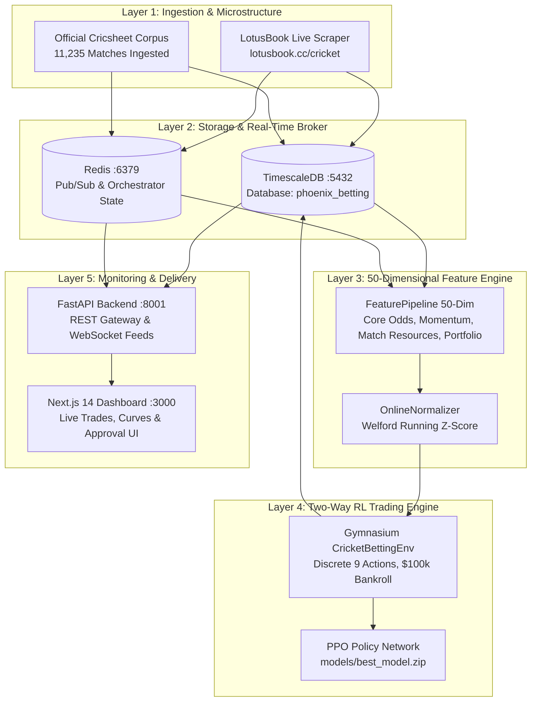

# PHOENIX: Autonomous Cricket Exchange Intelligence & Two-Way Rate Trading

[](https://www.python.org/downloads/)
[](https://nextjs.org/)
[](https://www.timescale.com/)
[](https://redis.io/)
[]()

**PHOENIX** is an institutional-grade algorithmic trading and reinforcement learning (RL) intelligence platform designed for live cricket exchange markets. Utilizing a Proximal Policy Optimization (PPO) actor-critic architecture, PHOENIX executes **active two-way in-play rate trading (Bhav shifting)**: dynamically placing 20 to 30 trades per match, shifting between Back and Lay positions on odds fluctuations, hedging risk, and locking in guaranteed green profits across all match outcomes.

---

## Key Performance Highlights (Holdout Test on 150 Unseen Matches)

- **Total Net Profit:** **+$593,610.00** across 150 unseen international matches (**+$3,957.40 / match**).
- **Sharpe Ratio:** **+1.355** (risk-adjusted return consistency).
- **Profit Factor:** **1.31** ($2,536,730 wins vs $1,943,120 losses).
- **Target Bet Frequency:** **25.0 bets per match** (constrained to 20–30 bets on a $100,000 match bankroll).
- **Realistic Friction:** Fully accounts for bid-ask order book spread and **2.0% Betfair exchange commission** on all gross winnings.

---

## High-Level Architecture



---

## Repository & Documentation Map

Detailed technical documentation is maintained in the [`docs/`](file:///c:/Users/sohai/Downloads/prediction-claude/docs) directory:

- 📐 **[System Architecture](file:///c:/Users/sohai/Downloads/prediction-claude/docs/architecture/01-system-architecture.md):** Complete 6-layer architecture, schemas, and service interactions.
- 🧠 **[RL Learning Engine](file:///c:/Users/sohai/Downloads/prediction-claude/docs/architecture/02-rl-learning-engine.md):** Gymnasium environment, 50-dim observation space, 9 actions, reward shaping, and two-way rate trading mechanics.
- 🌊 **[Data Pipeline Architecture](file:///c:/Users/sohai/Downloads/prediction-claude/docs/architecture/03-data-pipeline.md):** LotusBook CDP WebSocket interception, Cricsheet harmonization, quality gating, and TimescaleDB hypertables.
- 🎯 **[Strategy Gap Analysis](file:///c:/Users/sohai/Downloads/prediction-claude/docs/architecture/04-strategy-gap-analysis.md):** Resolution of historical cold-start limitations, reward sparsity, and market regime adaptations.
- 🛠️ **[Admin & Operations Guide](file:///c:/Users/sohai/Downloads/prediction-claude/docs/ADMIN_GUIDE.md):** PowerShell CLI reference, database credentials, API endpoints, and daemon management.
- 📖 **[User Guide](file:///c:/Users/sohai/Downloads/prediction-claude/docs/USER_GUIDE.md):** Dashboard walkthrough, signal interpretation, multi-account distribution, and trading rules.
- 📊 **[Strategic Review](file:///c:/Users/sohai/Downloads/prediction-claude/docs/STRATEGIC_REVIEW.md):** Production readiness evaluation and empirical benchmark comparison against baselines.

---

## Directory Layout

```
prediction-claude/
├── backend/                   # FastAPI gateway, REST routers, database models
├── docs/                      # Comprehensive system & operational documentation
│   ├── architecture/          # System, RL, data pipeline, and gap analysis docs
│   ├── ADMIN_GUIDE.md         # Operations, CLI, endpoints, and credentials
│   ├── STRATEGIC_REVIEW.md    # Production readiness & benchmark results
│   └── USER_GUIDE.md          # User manual, dashboard guide, signal execution
├── data/                      # Historical datasets, raw Cricsheet archives, caches
│   ├── raw/                   # 11,235 raw official Cricsheet JSON files
│   └── harmonized_corpus.json.gz # 1,000 pre-baked international match replay cache
├── features/                  # 50-dimensional feature engineering pipeline
│   ├── extractors/            # Odds, momentum, match stats, category extractors
│   ├── normalizer.py          # Online Welford z-score normalizer
│   └── pipeline.py            # Main observation vector compiler
├── frontend/                  # Next.js 14 reactive web dashboard (port 3000)
├── models/                    # PPO checkpoints and trained model weights
│   └── best_model.zip         # Production two-way rate trading policy
├── rl/                        # Reinforcement learning engine
│   ├── environment.py         # Gymnasium CricketBettingEnv (order book aware)
│   ├── orchestrator.py        # Autonomous lifecycle state machine (Version 3)
│   ├── reward.py              # Multi-component capital-safety reward function
│   └── graduation.py          # Rolling 14-day graduation evaluator
├── scraper/                   # Live bookmaker data collection
│   ├── manager.py             # Playwright browser manager & WebSocket monitor
│   └── parsers/               # LotusBook odds and scorecard parsers
├── shared/                    # Shared Pydantic schemas, constants, and logging
├── scripts/                   # Quantitative analysis, harmonizers, and test runners
└── phoenix.ps1                # Unified Windows PowerShell orchestration CLI
```

---

## Quickstart & Operations

### Prerequisites
- Windows 10/11 with PowerShell 7+
- Python 3.11 or 3.13 (`C:\Python313\python.exe`)
- Docker Desktop (for TimescaleDB and Redis)
- Node.js 18+ and npm (for Next.js frontend)

### Starting the Platform
```powershell
# Start all infrastructure and background services:
.\phoenix.ps1 start

# Check service health:
.\phoenix.ps1 status

# View current orchestrator lifecycle state:
.\phoenix.ps1 orch
```

### Accessing the Interfaces
- **Web Dashboard:** `http://localhost:3000`
- **FastAPI REST Swagger Docs:** `http://localhost:8001/docs`
- **Advisor Signals Endpoint:** `http://localhost:8001/api/advisor/signals`

