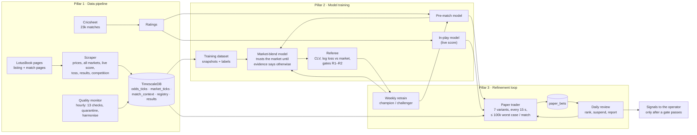

# PHOENIX: goal and architecture

Last updated 2026-11-03. This is the top-level document: what PHOENIX is for, the three pillars that get it there,
how each is built today, where each stands, and what comes next. Detailed designs are linked at the end.

## Primary goal: make profits

PHOENIX exists to make money betting on real cricket matches.

**What counts as profit.** A strategy is profitable when, after the bookmaker's margin and the delay of a person
placing the bet by hand, it wins more than it loses over many matches. The leading measure is **closing-line value
(CLV)**: whether our bets beat the price the market settles at (at the off for pre-match bets, 10 minutes later for
in-play bets). Consistently positive CLV is what long-run profit looks like before the sample is big enough for P&L to
prove it.

**Fixed constraints.**

- **Signals, not automation.** The app tells a person what to bet (side, minimum price, stake, reason); a person places
  it by hand. Backtests and paper trading assume a 60-second delay between signal and bet.
- **LotusBook is the market.** Betfair is blocked in the operator's country, and we do not route around the block.
  All prices come from our own LotusBook recordings.
- **Evidence before money.** Nothing reaches real money until it has passed the validation ladder (below). Real money
  is always the operator's decision. Check that betting is legal where you live before staking.

## The three pillars

The pillars form one loop. Better data feeds better models; models trade on paper; paper results and new recordings
decide which models and settings survive; the survivors trade the next matches.

---

### Pillar 1: the best data pipeline

**What "best" means.** Every live cricket match LotusBook lists is recorded, from its own match page, with prices that
belong to that match, timestamps that are true, names and competitions that agree across tables, and results that are
right. Problems are found automatically, not by someone noticing.

**How it is built.**

| Part | What it does |
|---|---|
| Listing worker | Reads the cricket listing every 3 s: every match, pre-match and live, back/lay per team |
| Match-page workers | One read-only page per live match (SRL included, up to 12 at once). Reads the page's own data feeds passively: every market (incl. ones the page does not show) with sizes, statuses and exchange timestamps; the live score, toss and result where the feed carries them |
| Competition map | From the site's own menu feed: every event's competition |
| Guards before every write | Quality gate (crossed or empty books), odds only from the match's own row, post-settlement and cross-match-copy refusal, change-only storage with a 5-min live heartbeat |
| Registry | One row per match: teams (canonical names), competition, start time (UTC), simulated flag, toss, score pipeline |
| Results | From decisive prices, the settled market, the score feed, or (by hand) public scorecards; a vanished match waits 45 min before it is called unresolved |
| Quality monitor | Hourly in Docker: freshness, price sanity, duplicates, match-page coverage, lay completeness, score coverage, registry, results, gaps, SRL, misattribution, model drift, paper trading. Quarantines bad rows (kept, with a reason) and fills missing competitions |
| Cricsheet | 23,193 historical matches (all formats and leagues) for team and player ratings |

**Where it stands (2026-11-03).** About 31 matches recorded since 1 November, about 84k match-page market rows, live
score recording ball by ball for matches on the score feed's `livescore-v2` source. The 24-hour monitor has no failures;
its remaining warning is one real 15-minute gap caused by a since-fixed bug.

**Known limits.** No live score for SRL matches and for real matches on the feed's `legacy` source (the only other
source is a widget that will not load in a headless browser; we do not disguise the browser). Cricsheet has no data for
some competitions we record (Ford Trophy, Emirates D20, NCL GT20, some domestic women's events) and none for
Afghanistan, so those matches have no strength-model view. Redeploying the scraper costs about a minute of recording.

**Next improvements.** Zero-downtime scraper restarts; verify the result wording when the first `livescore-v2` match
ends; per-source provenance on score rows; extend ratings to teams Cricsheet lacks from our own recorded results.

Details: `docs/runbooks/recording.md`, stories S37–S57, S67–S68.

---

### Pillar 2: the best model training strategy

**What "best" means.** A probability that beats the de-vigged LotusBook price where it matters, at the moment a person
can act, with honest uncertainty, and a referee that cannot be tuned into finding an edge that is not there.

**How it is built.**

| Part | What it does |
|---|---|
| Market module | One definition of the market's probability (power de-vig by default; Shin and multiplicative available), margin, favourite–longshot curve |
| Training dataset | Every recorded match as snapshots (6 h, 60 min, 10 min before, at the off, every 2 min in play) with the price 60 s and 10 min later as labels |
| Pre-match model | Team Elo, expected-XI player strength, venue, rest, tier, gender; stacked and Platt-calibrated; model chosen per fold without seeing the test season |
| In-play model | State model (score, wickets, overs, target, run rates) plus the pre-match block, trained ball by ball on Cricsheet |
| Market-blend model | Bayesian: starts as "the market is right" and moves only as far as settled recordings justify, with a posterior uncertainty |
| Staking | Bets only when the edge's lower bound clears a minimum at the price 60 s later; fractional Kelly shrunk by uncertainty; caps per trade, match and day |
| Referee | Pre-registered segments, paired bootstrap CIs, CLV-first policy simulation, gate report R1/R2 per segment |

**Where it stands.** Pre-match T20 model beats pure Elo on 13,827 held-out matches (log loss 0.6499 vs 0.6540, average
calibration error 0.7%); ODI is level with Elo. 7 of 19 real recorded matches can be rated. The blend still returns the
market price and every gate is "insufficient": not enough settled matches with a pre-match price yet. No model has
shown it beats the market.

**Next improvements.** Accumulate settled recordings (the binding constraint); use the toss (now recorded) in the
pre-match model; a state model for `livescore-v2` matches tuned on our own recordings; ratings for teams Cricsheet lacks.

Details: `docs/architecture/training-strategy.md`, stories S58–S67.

---

### Pillar 3: the best refinement loop

**What "best" means.** The system learns from every match it sees: it bets on paper, measures itself on CLV and P&L,
keeps what works, stops what does not, and retrains on new data, without anyone tuning it by hand, and without ever
mistaking luck for skill.

**How it is built.**

| Part | What it does |
|---|---|
| Paper trader | Every 15 s on every real match in play or within 6 h of the start. Seven variants side by side (model weight 0.3/0.5/0.7 × minimum edge 3%/6%, plus a market-only control). Backs or lays either team; enters, adds, reduces, flips and greens up as the match moves |
| Risk | Worst case per match ≥ −100,000 for each variant; at most 25,000 of new risk per trade |
| Fill realism | Decide on the price at t; fill at the takeable price 60 s later only if half the minimum edge remains |
| Ledger | `paper_bets`: every bet with what the model knew, the price asked and filled, settlement and CLV |
| Daily review (00:05 UTC) | CLV and P&L with confidence intervals, calibration, Thompson ranking, a labelled primary variant, suspension after a daily loss of 250,000, report in `reports/paper/` |
| Weekly retrain (Mon 03:00 UTC) | New Cricsheet data → pre-match model → dataset → blend → referee → registry; a challenger replaces the champion only with evidence |
| Trust gate | Real signals to the operator only for a version that has passed its rung |

**Where it stands.** Live since 2026-11-03 09:00 UTC. First paper bets filled and are being traded as matches move; none
settled yet.

**The validation ladder (the only path to real money).**

| Rung | Pass criterion on our own recordings |
|---|---|
| R1 model | Our probability beats the market's on log loss, 95% CI, ≥ 200 matches in a pre-registered segment |
| R2 strategy | Mean CLV > 0 and simulated P&L > 0 (95% CIs) after margin and the 60 s delay, ≥ 150 held-out matches |
| R3 paper live | ≥ 300 settled paper bets over ≥ 30 matches, CLV CI lower bound > 0 |
| R4 real money | The operator's decision, minimum stakes, kill switch on |

**Next improvements.** Feed settled paper outcomes into the weekly blend refit; adapt the variant grid from evidence
(drop losers, refine around winners); a dashboard of live positions and per-variant CLV.

Details: `docs/architecture/paper-trading.md`, stories S69–S73.

---

## Scorecard

| Pillar | Measure | Now (2026-11-03) | Target |
|---|---|---|---|
| Data | 24-hour monitor | no failures; 1 warning | no failures, no warnings |
| Data | Live matches with a match page | 100% | 100% |
| Data | `livescore-v2` matches with score rows | 100% | 100% |
| Training | Real recorded matches with a strength-model view | 7 of 19 | > 70% |
| Training | Gates passed (R1/R2) | none (insufficient data) | R1 in at least one segment |
| Refinement | Settled paper bets | 0 | 300 per variant over 30 matches |
| Refinement | Best variant CLV, 95% CI lower bound | n/a | > 0 |
| Goal | Real-money profit | not started | positive after R3 and the operator's go-ahead |

## Operator decisions on record

- 2026-11-02: no automated betting; signals only, placed by hand.
- 2026-11-02: Betfair blocked; LotusBook recordings replace it; no circumvention.
- 2026-11-03: record every live match including SRL; decide training use later (SRL stays excluded by default).
- 2026-11-03: downloaded Cricsheet's full archive.
- 2026-11-03: virtual betting with a worst case of 100,000 per match, trading both sides as a match moves.

## Document map

| Document | Covers |
|---|---|
| `docs/architecture/profit-architecture.md` | Where profit can come from; validation ladder; Betfair constraint |
| `docs/architecture/training-strategy.md` | Pillar 2 design and results |
| `docs/architecture/paper-trading.md` | Pillar 3 design |
| `docs/runbooks/recording.md` | Running and checking the recorder, quality monitor, quarantine |
| `docs/stories/S37`–`S73` | Implemented stories, one per change |
