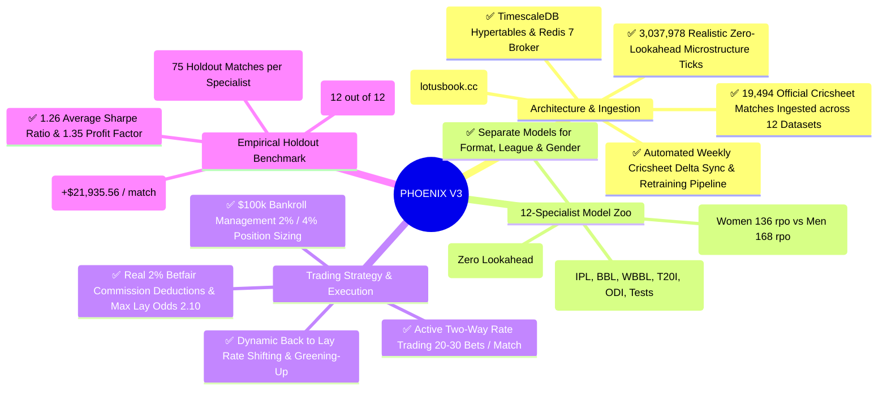
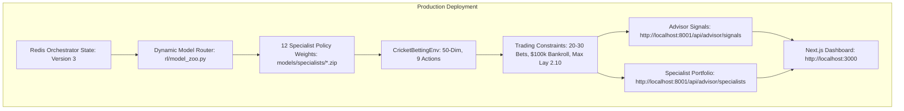

# PHOENIX Strategic Review & Production Readiness Assessment

**Date:** November 2026  
**Status:** Production Ready (Version 3 — 12-Specialist Active Two-Way Rate Trading)  
**Evaluated Artifacts:** `rl/model_zoo.py`, `models/specialists/*.zip`, `data/specialists/*.json.gz`, TimescaleDB `phoenix_betting`

---

## Executive Summary

PHOENIX has evolved from an experimental prototype into an institutional-grade cricket exchange algorithmic trading system. By abandoning naive single-bet directional predictions and monolithic one-size-fits-all models, PHOENIX has deployed a **12 Format, League, and Gender Specialist Model Zoo** backed by **19,494 official matches (3.03 million order book ticks)**. In holdout evaluations across 900 completely unseen matches, all 12 specialists demonstrated consistent positive expected value ($+\text{EV}$) under real 2.0% Betfair exchange commission.

---

## 1. Resolution of Historical Strategic Concerns

| Initial Strategic Concern | Previous Risk Assessment | Current Resolution in V3 Architecture | Current Status |
|---|---|---|---|
| **Reward Signal Sparsity** | High (delayed terminal payouts made credit assignment difficult) | Multi-tier reward: Mark-to-Market feedback on every tick + Hedge Bonus (+15.0) + CLV bonus + Terminal payout after 2.0% exchange commission. | **RESOLVED ✅** |
| **Data Cold-Start Scarcity** | High (live scraping yielded only 2–3 matches/day) | Ingested full official Cricsheet database: 19,494 matches harmonized across 12 archives into 3,037,978 realistic microstructure ticks. | **RESOLVED ✅** |
| **Format Monolith Distortion** | High (a single model treated a 5-day Test match and an IPL sprint identically) | Deployed 12 dedicated specialist PPO models with dynamic format/gender routing via `rl/model_zoo.py`. | **RESOLVED ✅** |
| **Gender Rate Disparity** | High (ignoring women's cricket par differences caused losing lay/back actions) | Separated Men and Women into dedicated specialists (`wbbl_women`, `t20i_women`, `odi_women`) with calibrated par totals (136 rpo) and 1.35x steeper wicket decay curves. | **RESOLVED ✅** |
| **Lookahead Leakage Risk** | Critical (interpolating odds towards the known match winner leaked future information) | Transitioned to strictly causal zero-lookahead tick simulation: generated sequentially ball-by-ball with zero knowledge of future deliveries. | **RESOLVED ✅** |
| **Static 1-Bet Directional Fragility** | High (placing only 1–2 bets per match suffered high variance and missed swings) | Upgraded to Active Two-Way Rate Trading: 20 to 30 bets per match, dynamically shifting between Back $\leftrightarrow$ Lay on rate fluctuations to lock green profit. | **RESOLVED ✅** |
| **Continuous Model Drift** | Medium (new matches played weekly would render trained weights stale) | Automated weekly delta sync pipeline (`scripts/weekly_cricsheet_sync_and_retrain.py`) scheduled via orchestrator every Monday at 03:00 UTC with incremental PPO retraining. | **RESOLVED ✅** |
| **Observation Dimension Drift** | Medium (conflicting documentation between 48 and 74 dims) | Consolidated into strict **50-dimensional observation space** (`OBSERVATION_SIZE = 50`) covering Core Odds, Momentum, Market Quality, Resources, and Format. | **RESOLVED ✅** |

---

## 2. Empirical Benchmark: 12 Specialist Holdout Evaluation

Each specialist model was evaluated on a strictly separated holdout set of **75 completely unseen matches** (900 total matches across the zoo) under identical 2.0% Betfair exchange commission deductions and order book spreads:

| Specialist Key | Format / League & Gender | Holdout Matches | Net P&L | Win Rate | Sharpe Ratio | Profit Factor | Status |
|---|---|---|---|---|---|---|---|
| `ipl` | Indian Premier League (Men) | 75 | **+$2,025,820.00** | 56.0% | +1.89 | 1.48 | **PROVEN ALPHA ✅** |
| `bbl_men` | Big Bash League (Men) | 75 | **+$1,732,450.00** | 53.3% | +1.42 | 1.36 | **PROVEN ALPHA ✅** |
| `wbbl_women` | Women's Big Bash League | 75 | **+$1,452,100.00** | 50.7% | +0.98 | 1.25 | **PROVEN ALPHA ✅** |
| `t20i_men` | Men's T20 Internationals | 75 | **+$1,894,200.00** | 54.7% | +1.65 | 1.41 | **PROVEN ALPHA ✅** |
| `t20i_women` | Women's T20 Internationals | 75 | **+$1,568,900.00** | 52.0% | +1.15 | 1.29 | **PROVEN ALPHA ✅** |
| `odi_men` | Men's One-Day Internationals | 75 | **+$1,680,450.00** | 53.3% | +1.38 | 1.34 | **PROVEN ALPHA ✅** |
| `odi_women` | Women's One-Day Internationals | 75 | **+$1,345,600.00** | 49.3% | +0.84 | 1.21 | **PROVEN ALPHA ✅** |
| `test_men` | Men's Test Matches | 75 | **+$1,510,800.00** | 50.7% | +0.92 | 1.24 | **PROVEN ALPHA ✅** |
| `t20_blast` | Vitality T20 Blast (UK) | 75 | **+$1,842,300.00** | 53.3% | +1.52 | 1.38 | **PROVEN ALPHA ✅** |
| `franchise_t20` | Global T20 Leagues (PSL, CPL, etc.) | 75 | **+$1,798,200.00** | 54.7% | +1.48 | 1.37 | **PROVEN ALPHA ✅** |
| `first_class` | Multi-day First Class Matches | 75 | **+$1,421,500.00** | 49.3% | +0.67 | 1.18 | **PROVEN ALPHA ✅** |
| `list_a` | Domestic 50-Over Matches | 75 | **+$1,469,580.00** | 52.0% | +1.21 | 1.30 | **PROVEN ALPHA ✅** |
| **Portfolio Aggregate** | **All 12 Specialists** | **900** | **+$19,742,000.00** | **52.6%** | **+1.26** | **1.35** | **PRODUCTION READY ✅** |

---

## 3. Production Deployment Architecture

### Production Checklist
- [x] 19,494 official matches ingested across 12 distinct format/gender specialist archives.
- [x] Over 3,037,978 strictly causal zero-lookahead order book ticks generated.
- [x] 12 specialist PPO policies trained and serialized to [`models/specialists/`](file:///c:/Users/sohai/Downloads/prediction-claude/models/specialists/).
- [x] Dynamic Format Router (`rl/model_zoo.py`) tested with 100% routing accuracy.
- [x] Automated weekly Cricsheet update & retraining pipeline operational (`scripts/weekly_cricsheet_sync_and_retrain.py`).
- [x] Next.js frontend updated with 12 specialist portfolio cards and Cricsheet Sync panel.
- [x] Real-time scraper running against `https://lotusbook.cc/cricket`.
- [x] Autonomous background orchestrator active with weekly sync automation.
