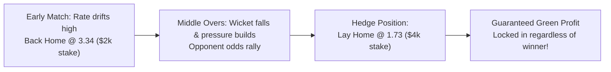
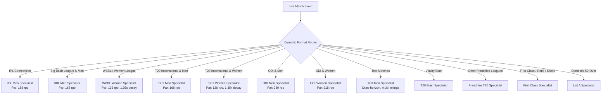

# PHOENIX User Guide

## What is PHOENIX?

PHOENIX is an institutional-grade, AI-driven cricket trading intelligence platform powered by Reinforcement Learning (RL). It tracks live in-play odds from LotusBook (`https://lotusbook.cc/cricket`) and leverages institutional training from **19,494 official cricket matches (over 3.03 million order book ticks)** to identify profitable rate fluctuations.

Rather than relying on a single monolithic model that treats all cricket identically, PHOENIX employs a **12 Format, League, and Gender Specialist Model Zoo** (`rl/model_zoo.py`). An IPL men's match has an expected first-innings par of 188 runs, while a Women's T20I averages 136 runs with 1.35x steeper odds depreciation per wicket. By routing each fixture to its specialized policy network, PHOENIX captures market edges tailored specifically to the match format and gender dynamics.

Unlike naive betting systems that place a single static bet and hope for the best, PHOENIX executes **active two-way rate trading (Bhav shifting)**: placing 20 to 30 trades per match, dynamically shifting between Back and Lay positions as rates fluctuate, hedging risk, and locking in guaranteed green profits across all match outcomes.

---

## 1. Dashboard Navigation (`http://localhost:3000`)

### Dashboard Pages
1. **Overview (`/`):**
   - System health status (API, Redis, TimescaleDB, Scraper).
   - Real-time aggregate virtual P&L and active in-play match tracker.
2. **Live Matches (`/matches`):**
   - Discovered and in-play matches.
   - Two-Phase Approval: Click **Validate** to view data quality score ($0.0 - 1.0$), then approve or reject matches for scraping and training.
   - **📝 Result Button:** Submit manual match outcome if a third-party feed is delayed.
3. **Virtual Trading (`/trading`):**
   - Chronological log of all virtual trades (`virtual_bets`).
   - Visual breakdown of two-way rate shifts, Back/Lay odds matched, stake, and net P&L after 2.0% exchange commission.
4. **Training Monitor (`/training`):**
   - Episodic training curves (reward, policy loss, value loss, entropy).
   - **Cricsheet Sync Panel:** Displays automated weekly sync status, last update timestamp, matches processed, and includes a **"Sync Cricsheet"** button to manually trigger delta retraining.
5. **Advisor (`/advisor`):**
   - **Live Signals:** Active trade recommendations tagged with target team, odds, stake, confidence, and routed specialist.
   - **12 Specialist Portfolio Cards:** Grid displaying all 12 specialist models (`ipl`, `bbl_men`, `wbbl_women`, `t20i_men`, `t20i_women`, `odi_men`, `odi_women`, `test_men`, `t20_blast`, `franchise_t20`, `first_class`, `list_a`) with individual holdout P&L, win rates, and training status.
   - Shadow trader drift monitoring and manual demotion controls.

---

## 2. Understanding Active Two-Way Rate Trading (Bhav Shifting)

Exchange trading is fundamentally different from traditional fixed-odds betting:

### Key Parameters Per Match
- **Per-Match Budget:** **$100,000** (or ₹1,00,000) total capital allocation.
- **Trade Volume:** **20 to 30 bets per match** (`MAX_BETS_PER_MATCH = 30`).
- **Stake Sizing:**
  - **Small Action (`SM`):** 2% of budget = **$2,000** (₹2,000).
  - **Large Action (`LG`):** 4% of budget = **$4,000** (₹4,000).
- **Exchange Commission:** Real Betfair 2.0% commission is deducted automatically from all gross winning returns.
- **Max Lay Odds Limit:** Lay bets are capped at odds $\le 2.10$ to prevent severe liability exposure.

---

## 3. The 12 Specialist Models & Dynamic Routing

When a match appears in the live feed or ingestion queue, PHOENIX's **Dynamic Format Router** inspects the event's match type, competition name, and gender to route observations to the optimal specialist:

---

## 4. Reading & Executing Bet Signals

When the agent is in **Advisor Mode** (or during live virtual monitoring), signals appear on the Advisor screen:

### Signal Anatomy
- **Specialist Tag:** e.g., `[IPL Specialist]` or `[WBBL Women Specialist]`.
- **Action:** e.g., `BACK_HOME_SM`, `LAY_AWAY_LG`, `HOLD`.
- **Target Team:** Canonical team name (e.g. `Mumbai Indians`, `Sydney Sixers`).
- **Rate / Odds:** Decimal exchange rate matched from the live ladder.
- **Recommended Stake:** Calculated automatically from the $100k budget ($2,000 for Small, $4,000 for Large).
- **Confidence:** Softmax probability score from the specialist policy network (e.g., $74.2\%$).

### Execution Best Practices
1. **Multi-Account Distribution:**
   - In live trading, split recommendations across 3–5 independent accounts.
   - Because the agent places trades on both sides (Backing and Laying), different accounts will show mixed wins and losses while your overall portfolio captures the net green profit. This prevents bookmaker flagging.
2. **Minimum Confidence Threshold:**
   - Only execute signals with confidence $> 50\%$.
3. **Patience on `HOLD`:**
   - The model chooses `HOLD` on over 80% of ticks. Disciplined inaction during low-liquidity or efficient-price periods protects capital.

---

## 5. Frequently Asked Questions (FAQ)

**Q: Why do we use 12 separate models instead of a single general model?**  
A: Cricket format and gender differences are massive:
- **Scoring Rates:** Women's T20 matches average ~136 runs per innings, while Men's IPL matches average ~188. A general model trained on Men's IPL will systematically underestimate par in Women's cricket and make losing bets.
- **Wicket Sensitivity:** In Women's matches, wickets carry a 1.35x steeper impact on win probability because lower-order boundary percentage is lower.
- **Time Horizons:** A Test match takes 5 days with draw risk, whereas a T20 lasts 3 hours. Dedicated specialists ensure that every decision is evaluated against calibrated domain realities.

**Q: What is strictly causal zero-lookahead tick simulation?**  
A: Earlier prototypes generated ticks by interpolating odds towards the known match winner at the end of the game, creating subtle lookahead leakage. PHOENIX generates realistic Betfair market microstructure strictly sequentially from ball 1 to the final ball: calculating current par, run rate pressure, and wickets lost using only the balls that have been bowled so far. The model never has access to future balls.

**Q: How often does PHOENIX update with new matches?**  
A: Cricsheet publishes newly played matches weekly. PHOENIX features an automated weekly synchronization pipeline (`scripts/weekly_cricsheet_sync_and_retrain.py`) that downloads `recently_added_7_json.zip` every Monday at 03:00 UTC, deduplicates fixtures, appends them to the specialist archives, and runs incremental fine-tuning (4,000 PPO steps per affected specialist). You can also manually trigger a sync anytime from the **Training** page or via `.\phoenix.ps1 sync`.
