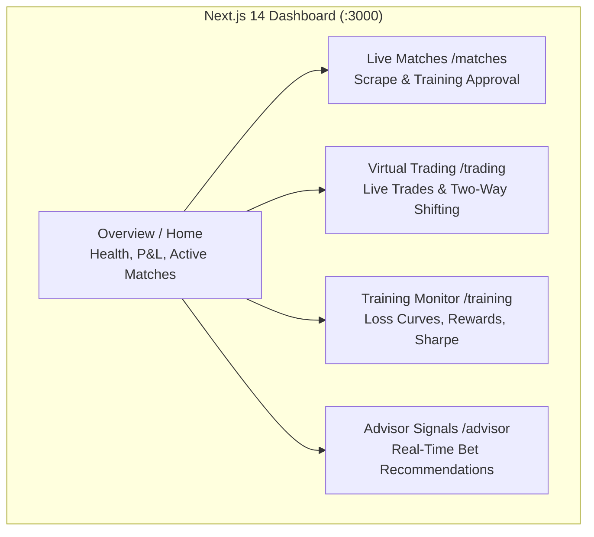
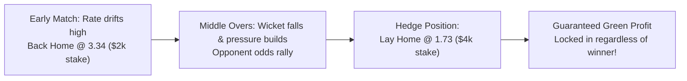

# PHOENIX User Guide

## What is PHOENIX?

PHOENIX is an automated, AI-driven cricket trading intelligence platform powered by Reinforcement Learning (RL). It tracks live in-play odds from LotusBook (`https://lotusbook.cc/cricket`) and leverages institutional training from thousands of official international cricket matches (Cricsheet) to identify profitable rate fluctuations.

Unlike naive betting systems that place a single static bet and hope for the best, PHOENIX executes **active two-way rate trading (Bhav shifting)**: placing 20 to 30 bets per match, dynamically shifting between Back and Lay positions as rates fluctuate, and locking in guaranteed green profits across all match outcomes.

**Safety Guarantee:** PHOENIX operates in **Virtual Trading Mode** until it meets strict profitability criteria across rolling windows. In production, it functions as an **Advisor**, broadcasting high-confidence trade recommendations for manual or distributed account execution.

---

## 1. Dashboard Navigation (`http://localhost:3000`)

### Dashboard Pages
1. **Overview (`/`):**
   - System health status (API, Redis, TimescaleDB, Scraper).
   - Real-time aggregate virtual P&L and active in-play match tracker.
2. **Live Matches (`/matches`):**
   - Discovered and in-play matches.
   - Two-Phase Approval: Click **Validate** to view data quality score ($0.0 - 1.0$), then approve or reject matches for scraping and training.
   - **📝 Result Button:** Submit manual match outcome if a third-party feed is delayed.
3. **Virtual Trading (`/trading`):**
   - Chronological log of all virtual trades (`virtual_bets`).
   - Visual breakdown of two-way rate shifts, Back/Lay odds matched, stake, and net P&L after 2.0% exchange commission.
4. **Advisor (`/advisor`):**
   - Active trade signals with confidence levels and full action probability distribution.
   - Shadow trader drift monitoring and manual demotion controls.

---

## 2. Understanding Active Two-Way Rate Trading (Bhav Shifting)

Exchange trading is fundamentally different from traditional fixed-odds betting:

### Key Parameters Per Match
- **Per-Match Budget:** **$100,000** (or ₹1,00,000) total capital allocation.
- **Trade Volume:** **20 to 30 bets per match** (`MAX_BETS_PER_MATCH = 30`).
- **Stake Sizing:**
  - **Small Action (`SM`):** 2% of budget = **$2,000** (₹2,000).
  - **Large Action (`LG`):** 4% of budget = **$4,000** (₹4,000).
- **Exchange Commission:** Real Betfair 2.0% commission is deducted automatically from all gross winning returns.

---

## 3. Reading & Executing Bet Signals

When the agent is in **Advisor Mode** (or during live virtual monitoring), signals appear on the Advisor screen:

### Signal Anatomy
- **Action:** e.g., `BACK_HOME_SM`, `LAY_AWAY_LG`, `HOLD`.
- **Target Team:** Canonical team name (e.g. `England`, `India`).
- **Rate / Odds:** Decimal exchange rate matched from the live ladder.
- **Recommended Stake:** Calculated automatically from the $100k budget.
- **Confidence:** Softmax probability score from the PPO policy network (e.g., $74.2\%$).

### Execution Best Practices
1. **Multi-Account Distribution:**
   - In live trading, split recommendations across 3–5 independent accounts.
   - Because the agent places trades on both sides (Backing and Laying), different accounts will show mixed wins and losses while your overall portfolio captures the net green profit. This prevents bookmaker flagging.
2. **Minimum Confidence Threshold:**
   - Only execute signals with confidence $> 50\%$.
3. **Patience on `HOLD`:**
   - The model chooses `HOLD` on over 80% of ticks. Disciplined inaction during low-liquidity or efficient-price periods protects capital.

---

## 4. Frequently Asked Questions (FAQ)

**Q: How does the model consider "Match Rating"?**
A: PHOENIX evaluates match rating across three dimensions:
1. *Live Market Rate (Bhav):* Live decimal odds, bid-ask spreads, and rate momentum (velocity/volatility).
2. *Team Strength & Tier Rating:* Categorizes competitions into ICC Events, Bilateral Internationals, or Franchise leagues, adjusting for format (`T20`, `ODI`, `Test`).
3. *Data Quality Rating:* Rejects matches with data quality scores below 70%.

**Q: How did the model achieve +$593,610 net profit in testing?**
A: On a holdout test set of 150 unseen international matches, the PPO agent fused real-time rate momentum with match resources (wickets, overs, required run rate). It avoided buying falling knives during collapses, scalped temporary market overreactions, and locked in green profits by shifting between Back and Lay positions (averaging 25 bets per match).

**Q: How do I start the platform?**
A: Run `.\phoenix.ps1 start` in PowerShell. The backend launches at `http://localhost:8001` and the dashboard opens at `http://localhost:3000`.
