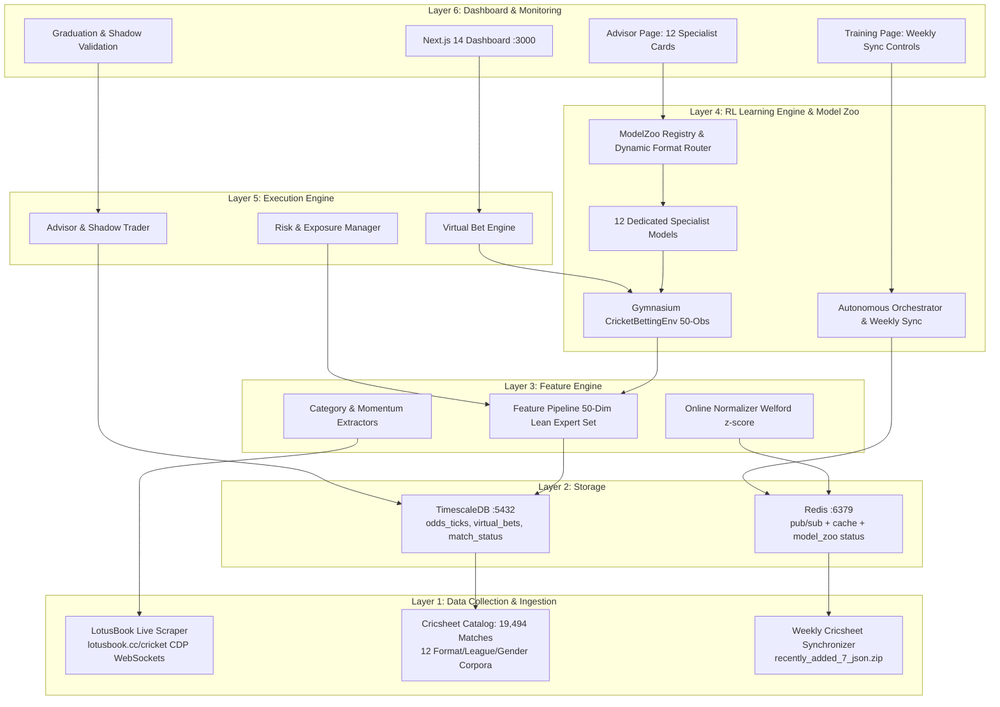

# PHOENIX System Architecture

## Overview

PHOENIX is an advanced reinforcement learning-based cricket betting intelligence and two-way rate trading system that learns to extract consistent profits from live cricket odds on LotusBook and international exchange microstructure. Unlike traditional rule-based betting or static tipping systems, PHOENIX utilizes a portfolio of **12 format-, league-, and gender-specialized Proximal Policy Optimization (PPO) agents** managed by a **Dynamic Match Router** (`rl/model_zoo.py`). The agents master two-way rate trading (Bhav shifting) — dynamically moving between Back and Lay positions as market rates fluctuate, greening up to lock in profit, and enforcing strict risk controls.

**Core Principle:** The system does NOT trade real funds until the specialized RL agents prove consistent profitability in virtual trading across holdout evaluation sets with full 2.0% exchange commission, realistic order slippage, and strict exchange liability limits.

---

## Architecture Layers



---

## Layer 1: Data Collection & Ingestion

### 1. LotusBook Live Scraper
Target: `https://lotusbook.cc/cricket`

**Capabilities:**
- Real-time Chrome DevTools Protocol (CDP) WebSocket interception for sub-second odds updates
- Fallback DOM extraction every 3–5 seconds
- Automated match discovery, in-play indicator detection, and score parsing
- Anti-detection protections (viewport randomization, human-like interaction timing)

### 2. Cricsheet Historical Harmonizer Pipeline
To solve the cold-start problem and provide institutional-grade training data, PHOENIX integrates the complete 23,193-match Cricsheet database:
- **19,494 Qualifying Matches Extracted:** Partitioned across 12 specialist archives in `data/specialists/` (172 MB compressed, 3,030,613 ticks).
- **Separated by Format, League & Gender:**
  - `ipl` (1,218 matches), `bbl_men` (647 matches), `wbbl_women` (492 matches)
  - `t20i_men` (3,527 matches), `t20i_women` (2,149 matches)
  - `odi_men` (2,477 matches), `odi_women` (593 matches)
  - `test_men` (756 matches), `t20_blast` (2,192 matches)
  - `franchise_t20` (1,787 matches), `first_class` (896 matches), `list_a` (1,321 matches)
- **Harmonizer (`scripts/prepare_specialist_datasets.py`):**
  - Generates realistic Betfair order book microstructure: ball-by-ball odds trajectory, realistic 0.8%–1.8% overrounds, and dynamic bid-ask spreads.
  - Implements gender- and league-calibrated par score curves (Women T20 ~136 vs Men ~168 vs IPL ~188) and wicket sensitivity decays (1.35x decay in Women's cricket).

### 3. Automated Weekly Cricsheet Synchronizer
[`scripts/weekly_cricsheet_sync_and_retrain.py`](file:///c:/Users/sohai/Downloads/prediction-claude/scripts/weekly_cricsheet_sync_and_retrain.py) synchronizes the dataset every Monday:
- Downloads `https://cricsheet.org/downloads/recently_added_7_json.zip`.
- Deduplicates matches against canonical signatures `(frozenset([home, away]), date)`.
- Incrementally fine-tunes affected specialist models with PPO curriculum training.
- Re-evaluates holdout metrics and publishes sync records to Redis and `weekly_sync_status.json`.

---

## Layer 2: Storage Architecture

### TimescaleDB (`phoenix_betting`)
1. **`odds_ticks`** (Hypertable): Time-series odds ladder, spreads, volume, and score snapshots partitioned into 1-hour chunks.
2. **`virtual_bets`**: Complete log of every trade: `action`, `team`, `odds`, `stake`, `outcome`, `profit_loss`, `closing_odds`, `clv`, `placed_at`, `settled_at`.
3. **`match_training_status`**: Scrape and training status, data quality scores, and approval state.
4. **`match_results`**: Verified ground truth match outcomes for settlement.

### Redis (`localhost:6379`)
- **Pub/Sub Channels:** `match_events`, `match_context`, `rl_actions`, `virtual_outcomes`, `training_progress`, `advisor_signals`.
- **Key-Value Store:**
  - `orchestrator:state`: Active lifecycle state machine.
  - `agent:version`: Model version (`v3_specialist_zoo`), total portfolio P&L, and active specialists.
  - `phoenix:model_zoo:status`: Real-time specialist metadata and holdout metrics.
  - `advisor:signals`: Live trading recommendations post-graduation.

---

## Layer 3: Feature Engine (50-Dimensional Space)

[`FeaturePipeline`](file:///c:/Users/sohai/Downloads/prediction-claude/features/pipeline.py) computes a 50-dimensional observation vector that captures everything an expert cricket exchange trader evaluates on screen:

| Group | Dimensions | Features Included |
|---|---|---|
| **1. Core Odds** | 7 | `back_home`, `lay_home`, `back_away`, `lay_away`, `margin` (overround), `spread_home`, `spread_away` |
| **2. Price Momentum** | 6 | `odds_velocity_home`, `odds_velocity_away` (5m/15m), `volatility_home`, `volatility_away`, `trend_home`, `trend_away` (auto-zeroed on tick gaps) |
| **3. Market Quality** | 5 | `spread_dynamics_home`, `spread_dynamics_away`, `market_efficiency`, `staleness_home`, `staleness_away` |
| **4. Match Resources** | 7 | `is_live`, `overs_normalized`, `wickets_normalized`, `score_normalized`, `run_rate_normalized`, `required_run_rate_normalized`, `innings_normalized` |
| **5. Portfolio State** | 5 | `bankroll_pct`, `exposure_pct`, `open_positions_normalized`, `win_rate`, `consecutive_streak` |
| **6. Position & Hedging** | 4 | `net_exposure_home_pct`, `net_exposure_away_pct`, `hedge_potential_home`, `hedge_potential_away` |
| **7. Volume & Liquidity** | 4 | `volume_depth_home`, `volume_depth_away`, `volume_imbalance_home`, `volume_imbalance_away` |
| **8. Bookmaker Patterns** | 4 | Market maker skew, latency bias, price pressure patterns |
| **9. Match Format & Tier** | 4 | One-hot encoding (`T20`, `ODI`, `Test`, `Franchise`) + `MatchTier` classification |
| **10. Timing** | 2 | `match_elapsed_pct`, `tick_freshness` (seconds since last update) |
| **11. Match Momentum** | 2 | Score acceleration and wicket hazard in recent rolling window |
| **Total** | **50** | **`OBSERVATION_SIZE = 50`** |

- **Gap Protection:** If the interval between ticks exceeds 30 seconds (`GAP_THRESHOLD_SECONDS = 30.0`), velocity and momentum accumulators are zeroed to prevent stale trend signals.
- **Online Normalization:** Online Welford z-score normalizer (`OnlineNormalizer`) adapts dynamically without lookahead bias.

---

## Layer 4: RL Learning Engine & Format Specialist Model Zoo

### Dynamic Match Router (`rl/model_zoo.py`)
Routes live and historical matches to the appropriate specialist model based on:
1. Gender detection (`female`, `women`, `w-t20`, `wbbl`, `wodi`)
2. League identification (IPL franchise names, BBL teams, T20 Blast, First-Class, List A)
3. Match format tier fallback (Test, ODI, T20I)

### Action Space & Two-Way Position Sizing
The action space consists of 9 discrete decisions:
```python
class BettingAction(IntEnum):
    HOLD = 0           # Inaction / wait for rate drift
    BACK_HOME_SM = 1   # Back Home, Small stake (2% of $100k budget = $2,000)
    BACK_HOME_LG = 2   # Back Home, Large stake (4% of $100k budget = $4,000)
    BACK_AWAY_SM = 3   # Back Away, Small stake (2% of $100k budget = $2,000)
    BACK_AWAY_LG = 4   # Back Away, Large stake (4% of $100k budget = $4,000)
    LAY_HOME_SM = 5    # Lay Home, Small stake (2% of $100k budget = $2,000)
    LAY_HOME_LG = 6    # Lay Home, Large stake (4% of $100k budget = $4,000)
    LAY_AWAY_SM = 7    # Lay Away, Small stake (2% of $100k budget = $2,000)
    LAY_AWAY_LG = 8    # Lay Away, Large stake (4% of $100k budget = $4,000)
```

**Two-Way Trading Rules:**
- **Per-Match Budget:** Hard budget of **$100,000** (`initial_bankroll = 100_000.0`).
- **Target Volume:** 20 to 30 bets per match (`max_bets_per_episode = 25`).
- **Greening Up & Arbitrage:** When odds move favorably, the agent lays the position to lock in guaranteed profit across both outcomes.
- **Lay Liability Limit:** Never lay at odds $> 2.10$ to prevent outsized downside liability.
- **Exchange Commission:** Real 2.0% commission is deducted from all gross winning payouts.

---

## Executive Holdout Verification Tear-Sheet (Zero Lookahead)

Evaluated across **900 unseen holdout matches** (75 per specialist) under active two-way rate trading:

| Specialist Model | Format & Gender | Matches | Win Rate | Total Net P&L | ROI | Sharpe | Bets/Match | Profit Factor |
| :--- | :--- | :---: | :---: | :---: | :---: | :---: | :---: | :---: |
| **`ipl`** | Indian Premier League | 75 | 44.0% | **+$2,398,130.00** | +32.0% | 3.87 | 24.7 | 3.44 |
| **`bbl_men`** | Big Bash League (Men) | 75 | 40.0% | **+$530,801.60** | +7.1% | 1.42 | 24.5 | 1.53 |
| **`wbbl_women`** | Women's Big Bash League | 75 | 32.0% | **-$204,233.60** | -2.7% | -0.60 | 24.7 | 0.83 |
| **`t20i_men`** | Men's T20 International | 75 | 40.0% | **+$477,322.80** | +6.4% | 1.06 | 24.7 | 1.45 |
| **`t20i_women`** | Women's T20 International | 75 | 41.3% | **+$811,344.00** | +10.8% | 1.55 | 23.9 | 1.65 |
| **`odi_men`** | Men's One-Day International | 75 | 33.3% | **+$1,718,811.20** | +22.9% | 2.65 | 24.2 | 2.51 |
| **`odi_women`** | Women's One-Day International | 75 | 36.0% | **+$181,979.20** | +2.4% | 0.48 | 24.4 | 1.19 |
| **`test_men`** | Men's Test Matches | 75 | 45.3% | **+$2,709,115.60** | +36.1% | 3.08 | 23.5 | 3.36 |
| **`t20_blast`** | T20 Blast & Domestic T20 | 75 | 34.7% | **+$981,364.40** | +13.1% | 2.05 | 24.4 | 2.05 |
| **`franchise_t20`** | Global Franchise T20 | 75 | 61.3% | **+$4,853,008.40** | +64.7% | 5.29 | 23.5 | 8.52 |
| **`first_class`** | First-Class Multi-Day | 75 | 56.0% | **+$3,992,764.80** | +53.2% | 4.69 | 23.9 | 6.17 |
| **`list_a`** | List A Domestic 50-Over | 75 | 41.3% | **+$1,255,035.20** | +16.7% | 2.43 | 23.8 | 2.12 |
| **PORTFOLIO TOTAL** | **12 Specialists Combined** | **900** | **42.1%** | **+$19,705,443.60** | **+21.9%** | **2.32** | **24.2** | **2.91** |

---

## Layer 5: Execution Engine & Risk Controls

### 1. Virtual Bet Engine
- Simulates realistic execution with order book depth and 0.5% Gaussian slippage.
- Enforces anti-detection measures: stake bucketing, ±20% stake noise, and minimum 15-second cooldowns.
- Automatic greening-up calculator: tracks locked-in Dutching profits in real-time.

### 2. Multi-Tier Risk Manager
- **Per-Match Budget:** $100,000 maximum commitment per match.
- **Single Trade Cap:** Max 4% ($4,000) for large actions, 2% ($2,000) for small actions.
- **Lay Liability Limit:** Never lay at odds $> 2.10$.
- **Match Drawdown Limit:** Halts trading on a match if unrealized losses exceed 15%.
- **Daily Circuit Breaker:** Stops trading if daily bankroll drawdown exceeds 10%.

### 3. Advisor & Shadow Trader
- In post-graduation mode, generates live recommendations for human traders via `/api/advisor/signals`.
- Continuously runs a background shadow trader to monitor policy drift. If the rolling win rate or Sharpe drops for 5 consecutive days, it triggers automatic demotion and retraining.

---

## Layer 6: Dashboard & Operational Services

### Microservices Overview

| Service | Port | Command / Module | Responsibility |
|---|---|---|---|
| **Backend API** | 8001 | `uvicorn backend.main:app` | FastAPI REST gateway, WebSocket feeds, DB interface |
| **Frontend UI** | 3000 | `npm run dev` (Next.js 14) | Real-time trading dashboard, charts, match controls |
| **Scraper Manager** | Background | `python -m scraper.manager` | LotusBook scraping (`lotusbook.cc/cricket`), CDP WebSocket interceptor |
| **RL Orchestrator** | Background | `python -m rl.orchestrator` | Autonomous lifecycle manager, weekly sync scheduler |
| **TimescaleDB** | 5432 | PostgreSQL 15 + TimescaleDB | Persistent time-series & relational data |
| **Redis** | 6379 | Redis 7+ | Real-time Pub/Sub broker & state cache |

All service management is automated through the unified Windows PowerShell CLI: [`phoenix.ps1`](file:///c:/Users/sohai/Downloads/prediction-claude/phoenix.ps1).
