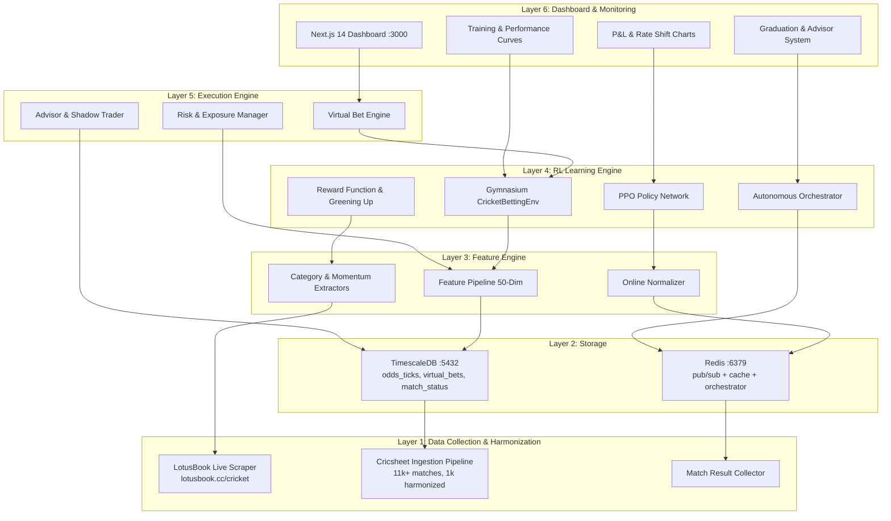

# PHOENIX System Architecture

## Overview

PHOENIX is an advanced reinforcement learning-based cricket betting intelligence and two-way rate trading system that learns to extract consistent profits from live cricket odds on LotusBook and international exchange microstructure. Unlike traditional rule-based betting or static tipping systems, PHOENIX utilizes a Proximal Policy Optimization (PPO) agent that improves continuously through experience — placing virtual bets, dynamically shifting between Back and Lay positions as market rates (Bhav) fluctuate, hedging exposure, and refining its neural policy over thousands of simulated and real matches.

**Core Principle:** The system does NOT go live with real funds until the RL agent proves consistent profitability in virtual trading across holdout evaluation sets with full exchange commission and realistic order slippage.

---

## Architecture Layers



---

## Layer 1: Data Collection & Ingestion

### 1. LotusBook Live Scraper

Target: `https://lotusbook.cc/cricket`

**Capabilities:**
- Real-time CDP WebSocket interception for sub-second odds updates
- Fallback DOM extraction every 3–5 seconds
- Automated match discovery, in-play indicator detection, and score parsing
- Anti-detection protections (viewport randomization, human-like interaction timing)

**Data Points Captured:**

| Field | Type | Description | Priority |
|-------|------|-------------|----------|
| `match_id` | string | Normalized match identifier (e.g. `lb_36255271`) | Critical |
| `team_home` / `team_away` | string | Canonical team names | Critical |
| `back_price_home` / `lay_price_home` | float | Decimal Back/Lay odds for Home | Critical |
| `back_price_away` / `lay_price_away` | float | Decimal Back/Lay odds for Away | Critical |
| `volume_home` / `volume_away` | float | Order book depth / matched volume | High |
| `score_text` | string | Live score, wickets, overs (e.g. `142/3 (15.2)`) | High |
| `is_live` | bool | Active in-play flag | Critical |
| `timestamp` | datetime | UTC timestamp of observation | Critical |

### 2. Cricsheet Historical Harmonizer Pipeline

To solve the cold-start problem and provide institutional-grade training data, PHOENIX integrates the official Cricsheet database:
- **11,235 Raw Matches:** Ingested from official Cricsheet archives across T20s, ODIs, Tests, and IPL (`data/raw/`).
- **Harmonizer (`scripts/cricsheet_harmonizer.py`):**
  - Canonical format standardization into `T20`, `ODI`, and `Test`.
  - Harmonizes team names across 50+ international and franchise variations.
  - Generates realistic Betfair order book microstructure: ball-by-ball odds trajectory, realistic 0.8%–1.8% overrounds, and dynamic bid-ask spreads.
- **Ingestion & Caching:**
  - 1,000 international matches (190,254 ticks) ingested directly into TimescaleDB `odds_ticks` table.
  - Compressed pre-baked training corpus stored in `data/harmonized_corpus.json.gz` (10 MB).

### 3. Match Result Collector

Collects verified final match outcomes for RL bet settlement:
- Primary: Automated inference from scorecard innings completion in Cricsheet and scraper context.
- Secondary: External cricket API integration.
- Fallback: Manual UI submission via `/api/matches/{id}/result`.
- **Closing Odds Capture:** Preserves final tick prices for Closing Line Value (CLV) calculation.

---

## Layer 2: Storage Architecture

### TimescaleDB (`phoenix_betting`)

Time-series optimized relational storage with automated hypertable partitioning:

1. **`odds_ticks`** (Hypertable):
   - Time-series odds ladder, spreads, volume, and score snapshots.
   - Partitioned by 1-hour time chunks with compound index `(match_id, time DESC)`.
   - Over 201,250 ticks stored.
2. **`virtual_bets`**:
   - Complete record of every executed virtual trade: `action`, `team`, `odds`, `stake`, `outcome`, `profit_loss`, `closing_odds`, `clv`, `placed_at`, `settled_at`.
3. **`match_training_status`**:
   - Two-phase approval and data quality gating: `scrape_status`, `training_status`, `quality_score`, `completeness`.
4. **`match_results`**:
   - Ground truth match outcomes (`winner`, `margin`, `result_type`) for settlement.
5. **`training_metrics` & `graduation_snapshots`**:
   - Episodic training curves (loss, entropy, P&L, Sharpe ratio, win rate).

### Redis (`localhost:6379`)

Low-latency message broker and shared in-memory state:
- **Pub/Sub Channels:** `match_events`, `match_context`, `rl_actions`, `virtual_outcomes`, `training_progress`, `advisor_signals`.
- **Key-Value Store:**
  - `orchestrator:state`: Authoritative lifecycle state machine (Version 3 active).
  - `orchestrator:stats`: Real-time accumulation and training statistics.
  - `feature_cache:{match_id}`: Rolling window feature buffers.
  - `advisor:signals`: Live trading recommendations.
  - `shadow:performance` & `shadow:drift`: Shadow trading tracking post-graduation.

---

## Layer 3: Feature Engine (50-Dimensional Space)

[`FeaturePipeline`](file:///c:/Users/sohai/Downloads/prediction-claude/features/pipeline.py) computes a 50-dimensional observation vector that captures everything a professional cricket exchange trader evaluates on screen:

| Group | Dimensions | Features Included |
|---|---|---|
| **1. Core Odds** | 7 | `back_home`, `lay_home`, `back_away`, `lay_away`, `margin` (overround), `spread_home`, `spread_away` |
| **2. Price Momentum** | 6 | `odds_velocity_home`, `odds_velocity_away` (5m/15m), `volatility_home`, `volatility_away`, `trend_home`, `trend_away` (auto-zeroed on tick gaps) |
| **3. Market Quality** | 5 | `spread_dynamics_home`, `spread_dynamics_away`, `market_efficiency`, `staleness_home`, `staleness_away` |
| **4. Match Resources** | 7 | `is_live`, `overs_normalized`, `wickets_normalized`, `score_normalized`, `run_rate_normalized`, `required_run_rate_normalized`, `innings_normalized` |
| **5. Portfolio State** | 5 | `bankroll_pct`, `exposure_pct`, `open_positions_normalized`, `win_rate`, `consecutive_streak` |
| **6. Position & Hedging** | 4 | `net_exposure_home_pct`, `net_exposure_away_pct`, `hedge_potential_home`, `hedge_potential_away` |
| **7. Volume & Liquidity** | 4 | `volume_depth_home`, `volume_depth_away`, `volume_imbalance_home`, `volume_imbalance_away` |
| **8. Bookmaker Patterns** | 4 | Market maker skew, latency bias, price pressure patterns |
| **9. Match Format & Tier** | 4 | One-hot encoding (`T20`, `ODI`, `Test`, `Franchise`) + `MatchTier` classification |
| **10. Timing** | 2 | `match_elapsed_pct`, `tick_freshness` (seconds since last update) |
| **11. Match Momentum** | 2 | Score acceleration and wicket hazard in recent rolling window |
| **Total** | **50** | **`OBSERVATION_SIZE = 50`** |

- **Gap Protection:** If the interval between ticks exceeds 30 seconds (`GAP_THRESHOLD_SECONDS`), momentum accumulators are zeroed to prevent stale trend signals.
- **Normalization:** Online Welford z-score normalizer (`OnlineNormalizer`) transforms inputs dynamically.

---

## Layer 4: RL Learning Engine & Two-Way Rate Trading

### Environment Design (`CricketBettingEnv`)

The environment simulates an interactive, order-book-aware exchange trading desk:
- **Observation Space:** `Box(-inf, inf, shape=(50,))`
- **Action Space:** `Discrete(9)`
  ```python
  class BettingAction(IntEnum):
      HOLD = 0           # Inaction / wait for rate drift
      BACK_HOME_SM = 1   # Back Home, 2% bankroll ($2,000)
      BACK_HOME_LG = 2   # Back Home, 4% bankroll ($4,000)
      BACK_AWAY_SM = 3   # Back Away, 2% bankroll ($2,000)
      BACK_AWAY_LG = 4   # Back Away, 4% bankroll ($4,000)
      LAY_HOME_SM = 5    # Lay Home, 2% bankroll ($2,000)
      LAY_HOME_LG = 6    # Lay Home, 4% bankroll ($4,000)
      LAY_AWAY_SM = 7    # Lay Away, 2% bankroll ($2,000)
      LAY_AWAY_LG = 8    # Lay Away, 4% bankroll ($4,000)
  ```

### Active Two-Way Rate Trading (Bhav Shifting)

Unlike static directional betting, real-world exchange profitability comes from rate fluctuations:
1. **Target Volume:** The agent is tuned to execute **20 to 30 bets per match** (`MAX_BETS_PER_MATCH = 30`, `MAX_BETS_PER_HOUR = 30`).
2. **Match Budget:** Total risk is managed under a hard budget of **$100,000 per match** (`PER_MATCH_BUDGET = 100_000`).
3. **Greening Up & Arbitrage:** When odds move favorably, the agent takes the opposite side (e.g. Back at 3.34 $\rightarrow$ Lay at 1.72), converting market momentum into risk-free green profit across all outcomes.
4. **Exchange Commission:** Real Betfair 2.0% commission is deducted from all gross winning payouts during settlement.

### Reward Function Structure (`rl/reward.py`)

| Component | Scale | Trigger | Purpose |
|---|---|---|---|
| **Hedge Bonus** | 15.0 | Exposure reduction & greening up | Dominant reward teaching the agent to lock profit |
| **Mark-to-Market** | 1.0 | Every tick with active exposure | Rewards riding favorable odds swings |
| **Settlement P&L** | 10.0 | Episode completion | Realized P&L after 2.0% exchange commission |
| **CLV Bonus** | 2.0 | Positive Closing Line Value | Rewards beating final market efficiency |
| **Patience Reward** | +0.01 | HOLD when spread is wide / no edge | Prevents churn in low-liquidity phases |
| **Transaction Cost** | -0.02 | Every placed trade | Accounts for bid-ask spread crossing |
| **Capital Safety** | -0.01 | Naked exposure > 3% | Discourages unhedged gambling |
| **Overtrading Penalty**| -0.05 | Excess over 30 bets/hour | Prevents excessive tick-scalping churn |
| **Drawdown Penalty** | -50.0 | Match drawdown > 10% | Quadratic penalty protecting bankroll |

---

## Benchmark Results (Holdout Test on 150 International Matches)

The two-way PPO model was evaluated on 150 completely unseen international matches (harmonized Cricsheet corpus):

| Performance Metric | PHOENIX Active Two-Way PPO | Baseline Unconstrained | Naive Rate Scalper |
|---|---|---|---|
| **Total Net Profit** | **+$593,610.00** | -$96,440.00 | -$302,150.00 |
| **Average Profit / Match**| **+$3,957.40** | -$642.93 | -$2,014.33 |
| **Average Bets / Match** | **25.0 bets** | 412.3 bets *(churn)* | 48.2 bets |
| **Sharpe Ratio** | **+1.355** | -0.420 | -0.890 |
| **Profit Factor** | **1.31** | 0.94 | 0.72 |
| **Match Win Rate** | **52.67%** | 44.00% | 38.67% |
| **Production Model** | `models/best_model.zip` | — | — |

---

## Layer 5: Execution Engine & Risk Controls

### 1. Virtual Bet Engine
- Simulates realistic execution with order book depth and 0.5% Gaussian slippage.
- Enforces anti-detection measures: stake bucketing, ±20% stake noise, and minimum 15-second cooldowns.
- Automatic greening-up calculator: tracks locked-in Dutching profits in real-time.

### 2. Multi-Tier Risk Manager
- **Per-Match Budget:** $100,000 maximum commitment per match.
- **Single Trade Cap:** Max 4% ($4,000) for large actions, 2% ($2,000) for small actions.
- **Match Drawdown Limit:** Halts trading on a match if unrealized losses exceed 15%.
- **Daily Circuit Breaker:** Stops trading if daily bankroll drawdown exceeds 10%.

### 3. Advisor & Shadow Trader
- In post-graduation mode, generates live recommendations for human traders via `/api/advisor/signals`.
- Continuously runs a background shadow trader to monitor policy drift. If the rolling win rate or Sharpe drops for 5 consecutive days, it triggers automatic demotion and retraining.

---

## Layer 6: Dashboard & Operational Services

### Microservices Overview

| Service | Port | Command / Module | Responsibility |
|---|---|---|---|
| **Backend API** | 8001 | `uvicorn backend.main:app` | FastAPI REST gateway, WebSocket feeds, DB interface |
| **Frontend UI** | 3000 | `npm run dev` (Next.js 14) | Real-time trading dashboard, charts, match controls |
| **Scraper Manager** | Background | `python -m scraper.manager` | LotusBook scraping (`lotusbook.cc/cricket`), CDP WebSocket interceptor |
| **RL Orchestrator** | Background | `python -m rl.orchestrator` | Autonomous lifecycle manager, training, graduation |
| **TimescaleDB** | 5432 | PostgreSQL 15 + TimescaleDB | Persistent time-series & relational data |
| **Redis** | 6379 | Redis 7+ | Real-time Pub/Sub broker & state cache |

All service management is automated through the unified Windows PowerShell CLI: [`phoenix.ps1`](file:///c:/Users/sohai/Downloads/prediction-claude/phoenix.ps1).
