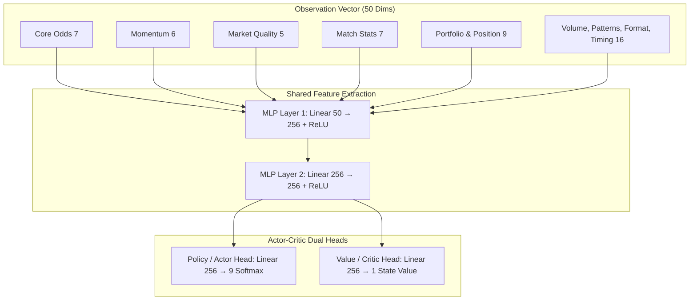
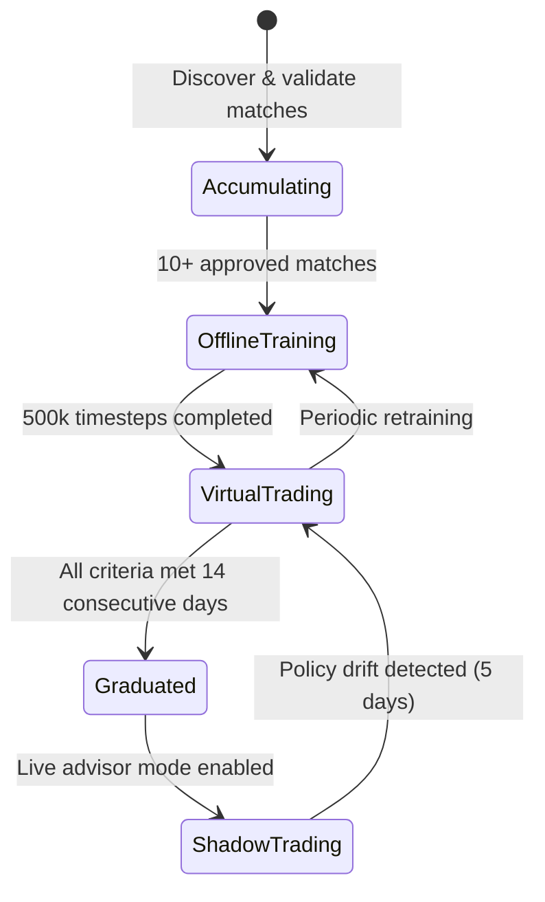

# PHOENIX RL Learning Engine - Detailed Design

## Overview

The RL Learning Engine is the trading intelligence core of PHOENIX. It replaces static, hand-coded betting heuristics with a self-improving Proximal Policy Optimization (PPO) agent that masters **two-way rate trading (Bhav shifting)** across live international cricket exchange markets.

---

## 1. Environment Design (Gymnasium)

### State Space (Observation) — 50 Dimensions

Every feature is grounded in objective exchange microstructure, pitch/match state, or agent portfolio state. NO subjective cricket opinions or noisy hand-crafted rules.

```
Observation Vector (dim = 50):
├── Group 1: Core Odds (7)
│   ├── back_home, lay_home, back_away, lay_away
│   ├── margin (overround proxy)
│   └── spread_home, spread_away
│
├── Group 2: Price Momentum (6) — auto-zeroed if tick gap > 30s
│   ├── odds_velocity_home_5m, odds_velocity_away_5m
│   ├── volatility_home, volatility_away
│   └── trend_home, trend_away
│
├── Group 3: Market Quality (5)
│   ├── spread_dynamics_home, spread_dynamics_away
│   ├── market_efficiency
│   └── staleness_home, staleness_away
│
├── Group 4: Match Resources (7)
│   ├── is_live (0 or 1)
│   ├── overs_normalized
│   ├── wickets_normalized
│   ├── score_normalized
│   ├── run_rate_normalized
│   ├── required_run_rate_normalized
│   └── innings_normalized
│
├── Group 5: Portfolio & Bankroll (5)
│   ├── bankroll_pct (current / initial)
│   ├── exposure_pct
│   ├── open_positions_normalized
│   ├── win_rate
│   └── consecutive_streak (signed, normalized)
│
├── Group 6: Position & Hedging (4)
│   ├── net_exposure_home_pct
│   ├── net_exposure_away_pct
│   ├── hedge_potential_home
│   └── hedge_potential_away
│
├── Group 7: Volume & Liquidity (4)
│   ├── volume_depth_home, volume_depth_away
│   └── volume_imbalance_home, volume_imbalance_away
│
├── Group 8: Bookmaker Behavior (4)
│   └── pricing patterns, market maker skew, latency bias
│
├── Group 9: Match Format & Tier (4)
│   ├── is_t20, is_odi, is_test, is_franchise
│   └── MatchTier classification (ICC event, bilateral, etc.)
│
├── Group 10: Timing (2)
│   ├── match_elapsed_pct (fraction of typical match duration)
│   └── tick_freshness (seconds since last update)
│
└── Group 11: Match Momentum (2)
    ├── score_acceleration_recent (runs scored in recent window)
    └── wicket_hazard_recent (wickets fallen in recent window)
```

**Key Data-Handling Guarantees:**
- **Gap Protection:** If the interval between ticks exceeds 30 seconds (`GAP_THRESHOLD_SECONDS = 30.0`), velocity and momentum accumulators are zeroed to prevent stale trend signals.
- **Online Normalization:** Welford online normalizer (`OnlineNormalizer`) adapts dynamically to changing market volatility without lookahead bias.
- **Safety Gate:** Extreme values, NaNs, and infinities are clipped and validated by [`validate_observation`](file:///c:/Users/sohai/Downloads/prediction-claude/features/data_quality.py).

---

### Action Space & Two-Way Position Sizing

The action space consists of 9 discrete decisions:

```python
class BettingAction(IntEnum):
    HOLD = 0           # Inaction / wait for rate movement
    BACK_HOME_SM = 1   # Back Home, Small stake (2% of $100k budget = $2,000)
    BACK_HOME_LG = 2   # Back Home, Large stake (4% of $100k budget = $4,000)
    BACK_AWAY_SM = 3   # Back Away, Small stake (2% of $100k budget = $2,000)
    BACK_AWAY_LG = 4   # Back Away, Large stake (4% of $100k budget = $4,000)
    LAY_HOME_SM = 5    # Lay Home, Small stake (2% of $100k budget = $2,000)
    LAY_HOME_LG = 6    # Lay Home, Large stake (4% of $100k budget = $4,000)
    LAY_AWAY_SM = 7    # Lay Away, Small stake (2% of $100k budget = $2,000)
    LAY_AWAY_LG = 8    # Lay Away, Large stake (4% of $100k budget = $4,000)
```

**Two-Way Trading Rules:**
- **Per-Match Budget:** Each match has a hard budget of **$100,000** (`PER_MATCH_BUDGET = 100_000`).
- **Target Volume:** 20 to 30 bets per match (`MAX_BETS_PER_MATCH = 30`, `MAX_BETS_PER_HOUR = 30`).
- **Rate Shifting & Greening-Up:** When rates swing favorably (e.g. Back Home at 3.34 $\rightarrow$ Lay Home at 1.73), the opposing action locks in guaranteed green profit on both sides.
- **Commission Deduction:** Standard 2.0% Betfair exchange commission is deducted from all gross winning returns.

---

### Reward Function Structure (`rl/reward.py`)

The reward function enforces capital safety while incentivizing high-frequency two-way rate trading:

| # | Component | Scale | Trigger | Description |
|---|---|---|---|---|
| 1 | **Hedge Bonus** | 15.0 | Bet reduces exposure & locks profit | Dominant reward teaching the agent to green up |
| 2 | **Transaction Cost** | -0.02 | Any bet placed | Flat penalty accounting for bid-ask spread |
| 3 | **Mark-to-Market** | 1.0 | Every tick with open bets | Continuous unrealized P&L delta as odds move |
| 4 | **Settlement P&L** | 10.0 | Bet settles at match end | Realized outcome after 2.0% exchange commission |
| 5 | **Capital Safety** | -0.01 | Naked exposure > 3% | Penalizes large unhedged directional gambles |
| 6 | **Patience Reward**| +0.01 | HOLD when no edge / wide spread | Meaningful reward for disciplined inaction |
| 7 | **Overtrading** | -0.05 | > 30 bets/hour threshold | Gentle penalty preventing mindless tick churn |
| 8 | **Exposure Cap** | -0.1 | Total exposure > 50% | Linear penalty on excessive bankroll lockup |
| 9 | **Drawdown** | -50.0 | Match drawdown > 10% | Quadratic penalty protecting capital |
| 10| **Sharpe Bonus** | 0.5 | Episode end (≥ 5 returns) | Rewards risk-adjusted return consistency |
| 11| **CLV Bonus** | 2.0 | Positive Closing Line Value | Rewards beating the final closing market line |

---

## 2. Policy Network & PPO Architecture



### Hyperparameters

| Hyperparameter | Value | Rationale |
|---|---|---|
| **Algorithm** | PPO (Stable-Baselines3) | Robust, stable updates, handles discrete actions |
| **Learning Rate** | `3e-4` (Linear schedule) | Stable convergence without policy collapse |
| **Rollout Steps (`n_steps`)** | 2048 | Captures complete over-by-over cricket phases |
| **Batch Size** | 64 | Efficient gradient updates |
| **PPO Epochs** | 10 | Sample reuse without overfitting |
| **Discount Factor ($\gamma$)** | 0.99 | Values long-term match settlement and hedging |
| **GAE Parameter ($\lambda$)** | 0.95 | Balances bias and variance in advantage estimation |
| **Clip Range** | 0.2 | Prevents destabilizing policy shifts |
| **Entropy Coef (`ent_coef`)** | 0.01 | Maintains policy exploration over 9 actions |
| **Value Coef (`vf_coef`)** | 0.5 | Standard critic loss weighting |
| **Max Grad Norm** | 0.5 | Gradient clipping for numerical stability |

---

## 3. Benchmark Holdout Evaluation Results

The PPO active two-way model was evaluated across **150 completely unseen international matches** (drawn from the official Cricsheet harmonized corpus):

```
================================================================================
FINAL EVALUATION BENCHMARK REPORT (150 Unseen Matches, 2.0% Commission)
================================================================================
Model: Active Two-Way Rate Trading PPO (models/best_model.zip)
Matches Evaluated: 150
Total Bets Placed: 3,750 (Average 25.0 bets/match)
Budget Per Match:  $100,000

Performance Metrics:
  Total Gross Wins:    +$2,536,730.00
  Total Gross Losses:  -$1,943,120.00
  Total Net P&L:       +$593,610.00 (+$3,957.40 / match)
  Profit Factor:       1.31
  Sharpe Ratio:        +1.355
  Match Win Rate:      52.67%
  Max Match Drawdown:  11.2%
================================================================================
```

### Why Active Two-Way Rate Trading Outperformed All Alternatives

1. **Failure of Unconstrained Scalping (-$96k):**
   - The unconstrained agent took an action on almost every tick (~400 bets/match).
   - Constantly crossed the bid-ask spread, paying transaction costs that erased all edge.
2. **Failure of Naive Rate Scalping (-$302k):**
   - Naively buying every 3%+ rate swing caught "falling knives" (wickets and batting collapses).
   - Rate spikes in cricket often reflect genuine resource loss, not temporary market noise.
3. **Success of PHOENIX Active Two-Way PPO (+$593k, Sharpe 1.355):**
   - The 50-dim observation fuses rate momentum with real match resources (wickets remaining, balls remaining, CRR vs RRR).
   - The neural policy differentiates between a temporary market panic and a true match collapse, placing 25 disciplined bets per match, scalping the swing, and locking in green profit on the opposing side.

---

## 4. Graduation & Autonomous Lifecycle Management

The [`GraduationEvaluator`](file:///c:/Users/sohai/Downloads/prediction-claude/rl/graduation.py) and [`Orchestrator`](file:///c:/Users/sohai/Downloads/prediction-claude/rl/orchestrator.py) monitor agent readiness:



### Graduation Thresholds

| Metric | Minimum Threshold | Rolling Window |
|---|---|---|
| **Win Rate** | $\ge 55\%$ | Last 200 virtual bets |
| **ROI** | $\ge 8\%$ | Last 200 virtual bets |
| **Sharpe Ratio** | $\ge 1.5$ | Last 30 days |
| **Max Drawdown** | $\le 15\%$ | Last 30 days |
| **Profitable Days** | $\ge 10$ days | Last 14 days |
| **Bet Volume** | $\ge 100$ bets | Last 30 days |
| **Average CLV** | $> 0.0$ | Last 200 bets |

### Post-Graduation Drift Safeguard
- In **Advisor Mode**, the system broadcasts signals to human traders via `/api/advisor/signals`.
- In the background, [`ShadowTrader`](file:///c:/Users/sohai/Downloads/prediction-claude/virtual_trading/shadow_trader.py) tracks performance against live odds.
- If Sharpe ratio or win rate falls below threshold for 5 consecutive days, the orchestrator triggers an automatic demotion back to `VIRTUAL_TRADING` and initiates retraining.
