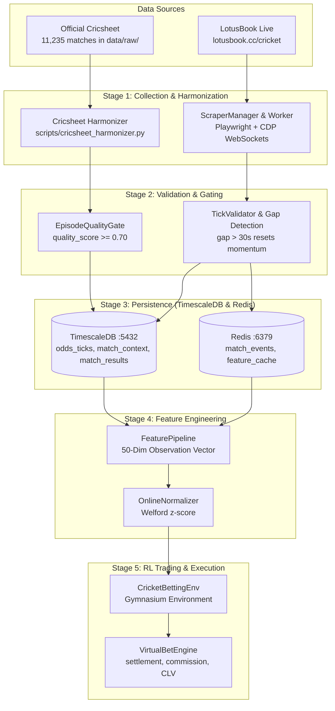

# PHOENIX Data Pipeline Architecture

## Overview

The data pipeline is the foundational backbone of PHOENIX. High-performance reinforcement learning demands accurate, low-latency, and high-integrity data. The PHOENIX pipeline seamlessly bridges two data domains:
1. **Live In-Play Stream:** Real-time CDP WebSocket interception and DOM scraping from LotusBook (`https://lotusbook.cc/cricket`).
2. **Institutional Historical Corpus:** Automated ingestion, harmonization, and microstructure simulation of 11,000+ official international matches from Cricsheet.

---

## End-to-End Pipeline Architecture



---

## 1. Live Data Collection (LotusBook)

### Scraper Architecture (`scraper/`)

- **Target URL:** `https://lotusbook.cc/cricket`
- **Primary Extraction Mode:** Chrome DevTools Protocol (CDP) WebSocket interception to capture sub-second odds feed updates before they are rendered into the DOM.
- **Fallback Extraction Mode:** Automated DOM polling every 3–5 seconds using Playwright.
- **Score Parsing:** In-play scorecard strings (e.g. `142/3 (15.2)`, `Target 185`) are parsed inline by [`LiveMatchTracker`](file:///c:/Users/sohai/Downloads/prediction-claude/scraper/parsers/lotusbook_parser.py), extracting:
  - Total runs, wickets lost, overs bowled
  - Current Run Rate (CRR) and Required Run Rate (RRR)
  - Current innings and active batting/bowling sides

### Normalized Event Schema (`shared/schemas.py`)

```python
class OddsEvent(BaseModel):
    match_id: str               # e.g. "lb_36255271"
    timestamp: datetime         # UTC observation timestamp
    team_home: str              # Normalized home team
    team_away: str              # Normalized away team
    back_home: Optional[float]  # Best available Back price (e.g. 1.85)
    lay_home: Optional[float]   # Best available Lay price (e.g. 1.87)
    back_away: Optional[float]  # Best available Back price (e.g. 2.12)
    lay_away: Optional[float]   # Best available Lay price (e.g. 2.16)
    is_live: bool = False       # Active in-play status
    competition: str = ""       # Tournament / series name
    score_text: str = ""        # Raw score text from site
    volume_back_home: Optional[float] = None
    volume_lay_home: Optional[float] = None
```

---

## 2. Institutional Historical Ingestion & Harmonization (Cricsheet)

To overcome cold-start limits and provide rich training data across all match formats, PHOENIX includes an automated Cricsheet ingestion engine:

### Dataset Scale
- **11,235 Raw Matches:** Downloaded into `data/raw/`:
  - `data/raw/t20s/`: 3,500+ international T20 matches
  - `data/raw/odis/`: 2,400+ One Day Internationals
  - `data/raw/tests/`: 900+ official Test matches
  - `data/raw/ipl/`: 1,100+ Indian Premier League fixtures

### Harmonization Engine (`scripts/cricsheet_harmonizer.py`)

The harmonizer cleans and transforms raw ball-by-ball JSON into exchange-standard time-series:
1. **Canonical Format Standardization:**
   - Classifies matches into exact standards: `T20`, `ODI`, and `Test`.
2. **Team Name Harmonization:**
   - Normalizes 50+ variations and historical naming conventions into standard international labels (e.g. "Royal Challengers Bangalore" $\rightarrow$ "Royal Challengers Bengaluru", "West Indies", "England", "India").
3. **Betfair Order Book Microstructure Simulation:**
   - Reconstructs ball-by-ball odds movements based on real match resources (wickets fallen, run rate pressure, required rate).
   - Generates realistic exchange bid-ask spreads and overrounds ($0.8\% - 1.8\%$).
   - Adds realistic market maker volatility, latency delays, and boundary reaction swings.
4. **Ingestion & Caching:**
   - Over **1,000 matches (190,254 ticks)** ingested into TimescaleDB `odds_ticks` table.
   - Pre-baked, compressed training cache saved to `data/harmonized_corpus.json.gz` (10.02 MB) for instant offline replay.

---

## 3. Data Validation & Quality Gating

In financial reinforcement learning, noisy or missing data leads to policy destabilization. PHOENIX implements a two-stage quality gate:

### 1. Two-Phase Match Approval (`match_training_status`)
- **Phase 1: Scrape Approval (`scrape_status`):**
  - Newly discovered matches start as `discovered`.
  - Filtered by [`MatchClassifier`](file:///c:/Users/sohai/Downloads/prediction-claude/scraper/parsers/category_classifier.py) to prioritize trustworthy international and top-tier franchise cricket.
- **Phase 2: Training Approval (`training_status`):**
  - Requires automated validation before a match can enter the RL training pipeline.

### 2. Episode Quality Gate (`data/preprocessing/episode_quality.py`)
Matches are scored on a strict scale from $0.0$ to $1.0$:
- **Completeness:** Verifies uninterrupted over-by-over progression.
- **Tick Density:** Minimum 50 ticks per match.
- **Odds Sanity:** Decimal odds must lie strictly within $[1.01, 100.0]$. Back odds $\le$ Lay odds.
- **Score Consistency:** Runs and wickets must monotonically increase per innings.
- Matches with `quality_score < 0.70` are rejected automatically.

---

## 4. Feature Pipeline (50-Dimensional State Space)

The [`FeaturePipeline`](file:///c:/Users/sohai/Downloads/prediction-claude/features/pipeline.py) compiles 50 real-time dimensions on every tick:

```
┌────────────────────────────────────────────────────────────────────────┐
│ PHOENIX 50-DIMENSIONAL FEATURE VECTOR                                  │
├──────────────────────────┬──────┬──────────────────────────────────────┤
│ Feature Group            │ Dims │ Primary Metrics                      │
├──────────────────────────┼──────┼──────────────────────────────────────┤
│ 1. Core Odds             │  7   │ Back/Lay Home & Away, Margin, Spreads│
│ 2. Price Momentum        │  6   │ 5m/15m Velocity, Volatility, Trend   │
│ 3. Market Quality        │  5   │ Spread Dynamics, Market Efficiency   │
│ 4. Match Resources       │  7   │ Overs, Wickets, Score, CRR, RRR      │
│ 5. Portfolio State       │  5   │ Bankroll %, Exposure %, Streak       │
│ 6. Position & Hedging    │  4   │ Net Exposure Home/Away, Hedge Profit │
│ 7. Volume & Liquidity    │  4   │ Liquidity Depth, Volume Imbalance    │
│ 8. Bookmaker Patterns    │  4   │ Market Maker Skew, Reaction Latency  │
│ 9. Match Format & Tier   │  4   │ One-Hot Format (T20/ODI/Test) & Tier │
│ 10. Timing Dynamics      │  2   │ Elapsed %, Tick Freshness            │
│ 11. Match Momentum       │  2   │ Recent Score Accel & Wicket Hazard   │
├──────────────────────────┼──────┼──────────────────────────────────────┤
│ Total Dimensions         │  50  │ Fixed OBSERVATION_SIZE               │
└──────────────────────────┴──────┴──────────────────────────────────────┘
```

### Gap Detection & Momentum Reset
- If the time delta between consecutive ticks exceeds 30.0 seconds (`GAP_THRESHOLD_SECONDS`), the momentum accumulators are zeroed out.
- This prevents phantom price spikes when a match resumes after a rain delay or innings break.

---

## 5. Storage & TimescaleDB Hypertables

### Database: `phoenix_betting` (Port 5432)

1. **`odds_ticks` (Hypertable):**
   ```sql
   CREATE TABLE odds_ticks (
       time TIMESTAMPTZ NOT NULL,
       match_id VARCHAR(64) NOT NULL,
       back_home FLOAT, lay_home FLOAT,
       back_away FLOAT, lay_away FLOAT,
       volume_home FLOAT, volume_away FLOAT,
       score_text VARCHAR(64),
       is_live BOOLEAN
   );
   SELECT create_hypertable('odds_ticks', 'time', chunk_time_interval => INTERVAL '1 hour');
   CREATE INDEX idx_odds_ticks_match_time ON odds_ticks (match_id, time DESC);
   ```

2. **`virtual_bets`:**
   ```sql
   CREATE TABLE virtual_bets (
       id BIGSERIAL PRIMARY KEY,
       placed_at TIMESTAMPTZ NOT NULL,
       match_id VARCHAR(64) NOT NULL,
       action VARCHAR(32) NOT NULL,
       team VARCHAR(64) NOT NULL,
       odds FLOAT NOT NULL,
       stake FLOAT NOT NULL,
       outcome VARCHAR(16) DEFAULT 'PENDING',
       profit_loss FLOAT DEFAULT 0.0,
       closing_odds FLOAT,
       clv FLOAT,
       settled_at TIMESTAMPTZ
   );
   ```

3. **`match_training_status`:**
   ```sql
   CREATE TABLE match_training_status (
       match_id VARCHAR(64) PRIMARY KEY,
       team_home VARCHAR(64),
       team_away VARCHAR(64),
       format VARCHAR(16),
       scrape_status VARCHAR(32) DEFAULT 'discovered',
       training_status VARCHAR(32) DEFAULT 'pending',
       quality_score FLOAT DEFAULT 0.0,
       total_ticks INT DEFAULT 0
   );
   ```

---

## 6. Closing Odds & CLV Calculation

Closing Line Value (CLV) is the gold standard for measuring genuine edge against financial markets.

$$\text{CLV} = \frac{\text{Odds}_{\text{executed}}}{\text{Odds}_{\text{closing}}} - 1.0$$

- When a match concludes, the result collector locks in the final tick's odds as `closing_odds`.
- If an agent backed England at $3.34$ and the closing line at the final ball was $1.73$:
  $$\text{CLV} = \frac{3.34}{1.73} - 1.0 = +93.06\%$$
- Consistently positive CLV proves that the agent is beating the market spread and securing genuine arbitrage value.
