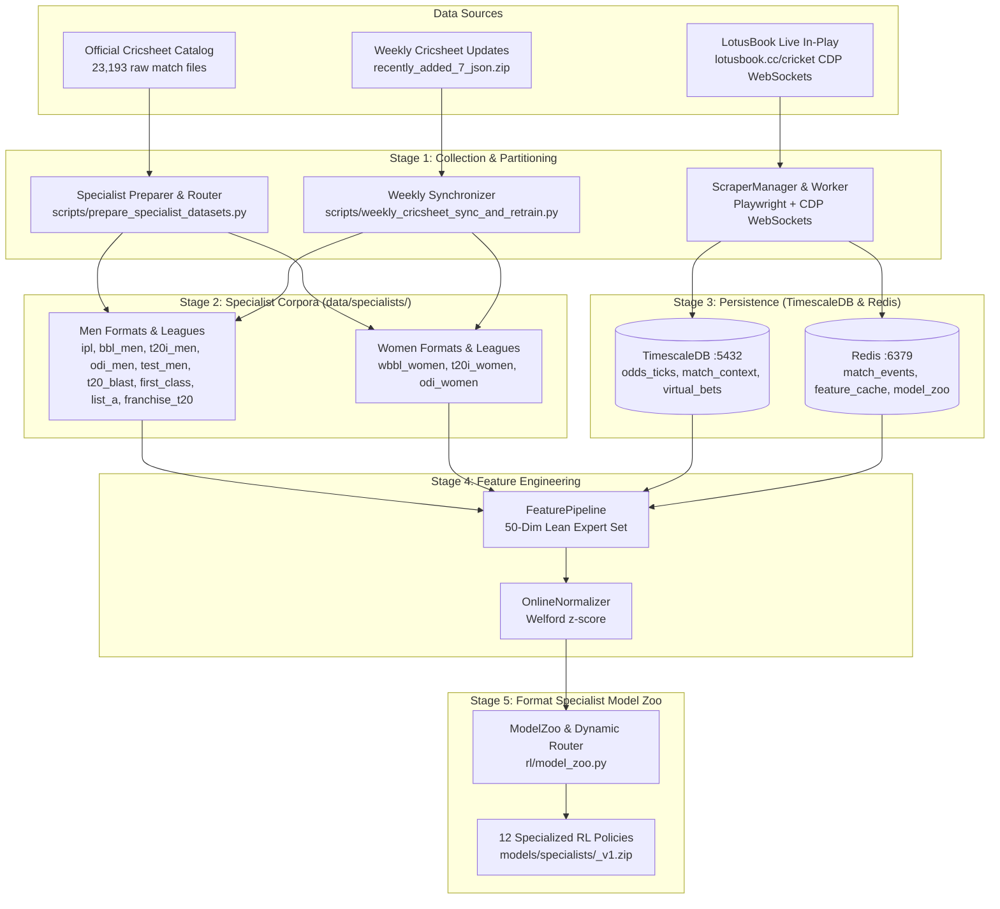

# PHOENIX Data Pipeline Architecture

## Overview

The data pipeline is the foundational backbone of PHOENIX. High-performance reinforcement learning demands accurate, low-latency, and high-integrity data. The PHOENIX pipeline seamlessly bridges two data domains:
1. **Live In-Play Stream:** Real-time Chrome DevTools Protocol (CDP) WebSocket interception and DOM scraping from LotusBook (`https://lotusbook.cc/cricket`).
2. **Institutional Historical Corpus:** Automated ingestion, harmonization, and microstructure simulation of 19,494 official matches partitioned into 12 dedicated format, league, and gender specialist datasets from Cricsheet.
3. **Automated Weekly Delta Synchronizer:** Autonomous weekly delta download (`recently_added_7_json.zip`), signature deduplication, and incremental specialist fine-tuning.

---

## End-to-End Pipeline Architecture



---

## 1. Live Data Collection (LotusBook)

### Scraper Architecture (`scraper/`)

- **Target URL:** `https://lotusbook.cc/cricket`
- **Primary Extraction Mode:** Chrome DevTools Protocol (CDP) WebSocket interception to capture sub-second odds feed updates before they are rendered into the DOM.
- **Fallback Extraction Mode:** Automated DOM polling every 3–5 seconds using Playwright with auto-recovery (forced page reloads every 100 polls or 5 consecutive zero polls).
- **Score Parsing:** In-play scorecard strings (e.g. `142/3 (15.2)`, `Target 185`) are parsed inline by [`LiveMatchTracker`](file:///c:/Users/sohai/Downloads/prediction-claude/scraper/parsers/lotusbook_parser.py), extracting:
  - Total runs, wickets lost, overs bowled
  - Current Run Rate (CRR) and Required Run Rate (RRR)
  - Current innings and active batting/bowling sides
- **Real-Time Active Tracking:** Active matches in Redis key `active_matches` are enriched with bookmaker odds (Back/Lay), scorecard text, and scheduled start times. Stale matches are dropped after 120 seconds of inactivity.

### Multi-Layer Match Filter & Governance (`scraper/match_filter.py`)

To protect the trading engine and model training corpus from corrupted data, non-standard rules, and simulated markets, all incoming matches must pass multi-layer filtering before discovery or collection:

1. **Layer 0: Hardened Blacklist Regex (Always Wins)**
   - Simultaneously inspects `event.competition`, `event.team_home`, and `event.team_away`.
   - Rejects any match matching patterns: `\bsrl\b`, `simulated`, `cyber`, `virtual`, `esport`, `electronic`, `fifa`, `t10`, `sixes`, `indoor`.
   - Prevents Simulated Reality League (SRL) or computer-simulated matches from infiltrating the pipeline, even when competition names are omitted or blank on bookmaker sites.
2. **Layer 1: Competition Name Whitelist**
   - Whitelists ICC tournaments (World Cups, Champions Trophy, World Test Championship) and major Tier-1 franchise leagues (IPL, BBL, WBBL, CPL, PSL, SA20, The Hundred, MLC, ILT20, BPL, Super Smash).
3. **Layer 2: Team Name Recognition**
   - Matches against `ALL_KNOWN_TEAMS` (all ICC Full/Associate member national teams and recognized franchise squads).
   - Supports feminine suffixes (`(w)`, `w`, `women`, `w.`) to recognize Women's Big Bash League (WBBL) and Women's Premier League (WPL) squads without alias duplication.
4. **Strict Verification Guard (`is_international_or_major`)**
   - Evaluates whether a fixture qualifies as an official international or major Tier-1 match.
   - Non-international matches, club games, and SRL fixtures ALWAYS evaluate to `False`, guaranteeing they can never be auto-approved.

### Two-Phase Gating Pipeline (`scraper/manager.py`)

Collection and training are strictly isolated into distinct approval gates:

```
[Discovered on LotusBook]
           │
     Layer 0-2 Filter
           │
   ┌───────┴────────────────┐
   ▼                        ▼
[Blacklisted / SRL]   [Qualifying Fixture]
 (Dropped)                  │
               ┌────────────┴────────────┐
               ▼                         ▼
      [Auto-Approve: OFF]       [Auto-Approve: ON]
     (Manual Approval Mode)    (Strict Tier-1 Only)
               │                         │
               │ (User Clicks Approve)   │ (is_international_or_major)
               └────────────┬────────────┘
                            ▼
                    ┌───────────────┐
                    │  SCRAPE GATE  │
                    │scrape_approved│
                    └───────┬───────┘
                            │
                    ┌───────┴───────┐
                    │   LIVE GATE   │ ──► Waits until in-play
                    └───────┬───────┘
                            │
                    ┌───────┴───────┐
                    │ SCHEDULE GATE │ ──► Waits until 10 min before start
                    └───────┬───────┘
                            ▼
                 Ingest Ticks to DB & Redis
                            │
                    (Match Concludes)
                            │
                 Data Quality Validation
                 (Completeness ≥ 70%, Score ≥ 0.70)
                            │
                    ┌───────┴───────┐
                    │ TRAINING GATE │ ──► Ingest to Specialist RL Corpus
                    └───────────────┘
```

1. **Scrape Gate (`scrape_status`):**
   - `discovered`: Match is detected and displayed on the dashboard for review. **Zero odds ticks are written to the database.**
   - `scrape_approved`: Ticks are stored to TimescaleDB and streamed to Redis live trading consumers.
   - `scrape_rejected`: Match is skipped and hidden from active tick capture.
2. **Live & Schedule Gates:**
   - Approved matches wait until 10 minutes prior to scheduled start and only capture ticks while `is_live=True`. Completed matches automatically stop recording.
3. **Training Gate (`training_status`):**
   - `pending`: Collected tick data awaits data quality scoring post-match.
   - `approved`: Validated matches ($score \ge 0.70$) eligible for RL model training.

### Runtime Governance & Dynamic API Controls

PHOENIX provides real-time control toggles via Redis and the Dashboard UI:
- **Redis Keys:**
  - `config:scraper:auto_approve`: `"false"` (default) / `"true"`.
  - `config:scraper:international_only`: `"false"` / `"true"` (default).
- **REST Endpoints:**
  - `GET /api/matches/settings`: Returns `{ auto_approve: bool, international_only: bool }`.
  - `POST /api/matches/settings`: Updates runtime toggles with instant propagation.
- **Memory Invalidation:** The scraper worker refreshes approved IDs every 5 seconds and immediately evicts blacklisted fixtures from memory when strict international filtering is enabled.

---

## 2. Institutional Historical Ingestion & Specialist Partitioning

To overcome cold-start limits and provide rich training data across all match formats, PHOENIX partitions the Cricsheet database into **12 distinct specialist archives** in `data/specialists/`:

| Specialist Key | Format & Gender / League | Matches | Ticks | Corpus File |
| :--- | :--- | :---: | :---: | :--- |
| **`ipl`** | Indian Premier League (Men) | **1,218** | 138,011 | `data/specialists/corpus_ipl.json.gz` |
| **`bbl_men`** | Big Bash League (Men) | **647** | 70,043 | `data/specialists/corpus_bbl_men.json.gz` |
| **`wbbl_women`** | Women's Big Bash League | **492** | 51,754 | `data/specialists/corpus_wbbl_women.json.gz` |
| **`t20i_men`** | Men's T20 International | **3,527** | 366,233 | `data/specialists/corpus_t20i_men.json.gz` |
| **`t20i_women`** | Women's T20 International | **2,149** | 202,672 | `data/specialists/corpus_t20i_women.json.gz` |
| **`odi_men`** | Men's One-Day International | **2,477** | 545,027 | `data/specialists/corpus_odi_men.json.gz` |
| **`odi_women`** | Women's One-Day International | **593** | 125,984 | `data/specialists/corpus_odi_women.json.gz` |
| **`test_men`** | Men's Test Matches | **756** | 335,813 | `data/specialists/corpus_test_men.json.gz` |
| **`t20_blast`** | T20 Blast & Syed Mushtaq Ali | **2,192** | 240,331 | `data/specialists/corpus_t20_blast.json.gz` |
| **`franchise_t20`** | Global Franchise T20 (CPL, PSL, BPL) | **1,787** | 267,087 | `data/specialists/corpus_franchise_t20.json.gz` |
| **`first_class`** | First-Class Multi-Day (County Champ) | **896** | 351,381 | `data/specialists/corpus_first_class.json.gz` |
| **`list_a`** | List A Domestic 50-Over | **1,321** | 287,277 | `data/specialists/corpus_list_a.json.gz` |
| **TOTAL** | **All 12 Specialist Corpora** | **19,494** | **3,030,613** | **172 MB compressed** |

### TimescaleDB Continuous Synchronization Architecture
To guarantee that the UI, API, and training management interfaces are always in 100% forensic synchronization with the historical corpus archives on disk:
- **`match_training_status.tick_count` Direct Indexing**: Each match record stores its teams, tournament, start time, approval gates, and authoritative `tick_count` directly. This eliminates expensive hypertable group-by aggregation scans across millions of ticks, cutting API query latencies from >1000ms to <35ms.
- **Universal Catalog Persistence**: Over 28,470 unique historical matches across all 12 specialist formats and domestic tournaments are stored and queryable in TimescaleDB with instant pagination and filtering.
- **Continuous Automated Sync**: When [`scripts/weekly_cricsheet_sync_and_retrain.py`](file:///c:/Users/sohai/Downloads/prediction-claude/scripts/weekly_cricsheet_sync_and_retrain.py) appends new weekly fixtures or [`scraper/manager.py`](file:///c:/Users/sohai/Downloads/prediction-claude/scraper/manager.py) ingests live in-play ticks, database counters update atomically so UI counters never drift.

### Microstructure Simulation Engine
1. **Betfair Order Book Microstructure:**
   - Reconstructs ball-by-ball odds movements based on real match resources (wickets fallen, run rate pressure, required rate).
   - Generates realistic exchange bid-ask spreads and overrounds ($0.8\% - 1.8\%$).
   - Calibrated to gender rate strategies: Women's T20 par ~136 rpo (1.35x steeper decay on wickets) vs Men's ~168 rpo vs IPL ~188 rpo.
2. **Strict Causal Zero-Lookahead Guarantee:**
   - Evaluates state strictly from forward features $(innings, overs, score, wickets, target)$ at time $t$.
   - Never accesses match winner or `_meta` outcomes during trading evaluation.

---

## 3. Automated Weekly Synchronization Pipeline

Implemented in [`scripts/weekly_cricsheet_sync_and_retrain.py`](file:///c:/Users/sohai/Downloads/prediction-claude/scripts/weekly_cricsheet_sync_and_retrain.py):

1. **Scheduled Automated Execution**:
   - The 24/7 background orchestrator daemon (`rl/orchestrator.py`) runs the synchronizer every Monday at 03:00 UTC.
2. **Delta Download**:
   - Fetches `https://cricsheet.org/downloads/recently_added_7_json.zip`.
3. **Deduplication Engine**:
   - Computes canonical signature `get_match_signature(team_home, team_away, date)` for incoming matches against existing signatures.
   - Prevents duplicate ingestion.
4. **Incremental Fine-Tuning**:
   - For specialists that received new matches, runs 4,000 steps of incremental PPO curriculum learning.
   - Evaluates holdout test performance and updates `models/specialists/weekly_sync_status.json` and Redis.

---

## 4. Feature Pipeline (50-Dimensional State Space)

The [`FeaturePipeline`](file:///c:/Users/sohai/Downloads/prediction-claude/features/pipeline.py) compiles 50 real-time dimensions on every tick:

```
┌────────────────────────────────────────────────────────────────────────┐
│ PHOENIX 50-DIMENSIONAL FEATURE VECTOR                                  │
├──────────────────────────┬──────┬──────────────────────────────────────┤
│ Feature Group            │ Dims │ Primary Metrics                      │
├──────────────────────────┼──────┼──────────────────────────────────────┤
│ 1. Core Odds             │  7   │ Back/Lay Home & Away, Margin, Spreads│
│ 2. Price Momentum        │  6   │ 5m/15m Velocity, Volatility, Trend   │
│ 3. Market Quality        │  5   │ Spread Dynamics, Market Efficiency   │
│ 4. Match Resources       │  7   │ Overs, Wickets, Score, CRR, RRR      │
│ 5. Portfolio State       │  5   │ Bankroll %, Exposure %, Streak       │
│ 6. Position & Hedging    │  4   │ Net Exposure Home/Away, Hedge Profit │
│ 7. Volume & Liquidity    │  4   │ Liquidity Depth, Volume Imbalance    │
│ 8. Bookmaker Patterns    │  4   │ Market Maker Skew, Reaction Latency  │
│ 9. Match Format & Tier   │  4   │ One-Hot Format (T20/ODI/Test) & Tier │
│ 10. Timing Dynamics      │  2   │ Elapsed %, Tick Freshness            │
│ 11. Match Momentum       │  2   │ Recent Score Accel & Wicket Hazard   │
├──────────────────────────┼──────┼──────────────────────────────────────┤
│ Total Dimensions         │  50  │ Fixed OBSERVATION_SIZE               │
└──────────────────────────┴──────┴──────────────────────────────────────┘
```

### Gap Detection & Momentum Reset
- If the time delta between consecutive ticks exceeds 30.0 seconds (`GAP_THRESHOLD_SECONDS`), momentum accumulators are zeroed out.
- Prevents phantom price spikes when a match resumes after a rain delay or innings break.
