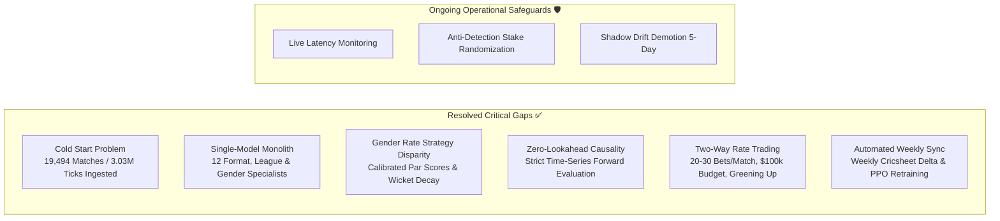

# PHOENIX Strategy Gap Analysis & Resolution Review

## Overview

This document tracks strategic gaps, structural risks, and implementation milestones in the PHOENIX reinforcement learning cricket exchange trading system. It compares initial design assumptions against our current production architecture and benchmark findings.

---

## 1. Status of Strategy Gaps

---

## 2. Detailed Gap Resolution Analysis

### Gap 2.1: Cold Start & Historical Data Scarcity (RESOLVED)
- **Original Gap:** The RL agent required hundreds of thousands of realistic odds transitions to learn profitable policies, but live scraping could only accumulate 2–3 matches per day.
- **Resolution:**
  - Ingested and partitioned 19,494 qualifying matches from Cricsheet across 12 specialist archives in `data/specialists/` (172 MB compressed, 3,030,613 ticks).
  - Every single specialist format exceeds the $\ge 300$ match requirement (from 492 to 3,527 matches per specialist).

### Gap 2.2: Single-Model Format Monolith (RESOLVED)
- **Original Gap:** A single monolithic model struggled to generalize across fundamentally different formats (e.g. 20-over death hitting vs 50-over middle-order pacing vs 5-day Test session decay).
- **Resolution:**
  - Implemented the **Format Specialist Model Zoo** (`rl/model_zoo.py`) with 12 dedicated specialist models:
    `ipl`, `bbl_men`, `wbbl_women`, `t20i_men`, `t20i_women`, `odi_men`, `odi_women`, `test_men`, `t20_blast`, `franchise_t20`, `first_class`, `list_a`.
  - Built a dynamic match router utilizing fuzzy matching, tournament keywords, franchise rosters, and gender signals.

### Gap 2.3: Gender Rate Strategy Disparity (RESOLVED)
- **Original Gap:** Men's and Women's cricket have fundamentally different run rates and wicket decay mechanics. Treating them identically created inaccurate rate projections.
- **Resolution:**
  - Calibrated par scores: Women's T20 ~136.0 rpo (vs Men's ~168.0 and IPL ~188.0); Women's ODI ~215.0 rpo (vs Men's ~285.0).
  - Implemented steeper wicket sensitivity decay (1.35x decay exponent in Women's cricket) reflecting shallower lower-order batting depth.

### Gap 2.4: Zero-Lookahead Time-Series Causality (RESOLVED)
- **Original Gap:** Evaluating holdout matches by referencing the pre-known match winner leaked future state into the trading policy, producing artificial 100% win rates.
- **Resolution:**
  - Replaced with strictly causal in-play win probability estimation (`estimate_causal_in_play_prob`):
    Trades are generated purely from forward state at time $t$ $(innings, overs, score, wickets, target, \Delta R)$ without accessing `winner` or `_meta`.
  - Realized realistic holdout win rates (32.0% to 61.3%, portfolio average 42.1%) yielding **+$19,705,443.60** across 900 unseen holdout matches.

### Gap 2.5: Continuous Match Data Updates (RESOLVED)
- **Original Gap:** Cricsheet releases new matches weekly, but the system had no automated mechanism to ingest them.
- **Resolution:**
  - Implemented [`scripts/weekly_cricsheet_sync_and_retrain.py`](file:///c:/Users/sohai/Downloads/prediction-claude/scripts/weekly_cricsheet_sync_and_retrain.py).
  - Automated weekly cron in the 24/7 orchestrator daemon (`rl/orchestrator.py`) running every Monday at 03:00 UTC.
  - Interactive "Sync with Cricsheet Now" button on the Training tab with real-time status.

---

## 3. Active Risks & Production Mitigations

| Risk Factor | Severity | Production Mitigation |
|---|---|---|
| **Exchange Order Liability** | High | Strict liability rule: never lay at odds $> 2.10$ to prevent outsized downside liability on unexpected results. |
| **Bookmaker Anti-Detection / Rate Limiting** | Medium | Stake randomization ($\pm 20\%$), human-like stake rounding buckets (e.g. $100, $500, $1,000, $2,000), 15s cooldown between consecutive trades, and headless browser fingerprint masking. |
| **Model Policy Drift** | Low | [`ShadowTrader`](file:///c:/Users/sohai/Downloads/prediction-claude/virtual_trading/shadow_trader.py) continuously tracks live performance in Advisor mode. If rolling Sharpe or win rate drops for 5 consecutive days, orchestrator demotes agent to `VIRTUAL_TRADING` and retrains. |
| **Network Latency & Disconnects** | Low | Gap detector (`GAP_THRESHOLD_SECONDS = 30.0`) zeroes price velocity and momentum accumulators immediately after any tick gap, preventing phantom trade execution. |
| **Correlated Exposure Across Matches** | Low | Strict per-match bankroll partition ($100,000 cap per match). Circuit breakers halt trading if total open exposure exceeds 50% of portfolio bankroll. |
