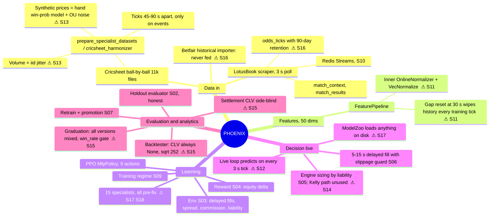

# PHOENIX strategy and data-flow review (second pass, `443c42e`, 2026-11-02)

S01–S10 are committed and the suite shows 214 passed. This pass maps the system end to end, asks whether the
profit strategy can work, and traces every data and analysis path. Stories S11–S18 come out of it.

## End-to-end mind map

## Is the profit strategy the best one?

**No. As built, it cannot show a real edge, and it may be learning a fake one.**

1. **The only market it has ever seen is our own formula.** The training price is `f(state) + OU noise`,
   and `state` is in the observation. The policy can learn `f` and trade the noise reverting, which wins
   by construction. Real markets already price the public state. The positive holdout ROI in
   `metadata.json` is what this artefact predicts, and those numbers also predate the leak fix. → **S13**
   removes the free edge and adds a null test that must show about −costs.
2. **What the policy sees live is not what it trained on** (S11, S12):
   - In training, history features are always empty, because of the 30 s gap rule against 45–90 s ticks.
   - Live, they are full.
   - Live, it decides about 20× more often than in training.
   - The two normalisers disagree.
3. **No real-odds data has ever been evaluated.** The scraper records real prices and the 90-day retention then
   deletes them. → **S16** keeps and replays them; that is the only place a real edge can be shown.
4. **Better strategy structure: separate prediction from execution.**
   - **Fair value:** a calibrated supervised win-probability model on Cricsheet. That is legitimate, because
     outcomes are labels on a match-level split. → **S14**.
   - **Entry:** trade only when the price beats fair value by more than commission plus half the spread.
     LotusBook is a bookmaker-style market that can lag. That lag, not microsecond latency, is the realistic
     edge: our 3 s poll plus 5–15 s delay rules latency out.
   - **Sizing:** fractional Kelly from that probability. `engine._target_liability` already supports it; the live
     loop never passes `win_prob`.
   - **Exit:** green up after a favourable move.
   - **RL's role:** RL is then the *challenger* that must beat this value policy on the same episodes, not the
     only alpha source. If it cannot beat it on recorded odds, ship the value policy.
5. **Graduation measures the wrong thing** (S15):
   - win rate ≥ 55% rewards laying favourites;
   - CLV has three definitions, and the lay sign is wrong;
   - Sharpe drops zero days and annualises by √252;
   - bets from every model version are mixed together.
6. **Safety:** all 15 active specialists are pre-remediation, and the zoo trades whatever is on disk.
   → **S17** gate now; **S18** rebuilds them and writes a report built only from JSON outputs.

## Data-flow checks that passed

- Outcome keys are confined to `SETTLEMENT_ONLY_KEYS` (S01); the leak audit script exists.
- Delayed live fills re-read the latest price, reject suspended or completed markets, and enforce a slippage limit
  (`live_trading_loop.py:196-287`).
- The S02 evaluator drives the real model with side-aware CLV and baselines.
- Retention on `odds_ticks` is only applied after the historical copy is verified (`db_init.py:138-205`).

## Order of work

Wave 5 runs in parallel: S11, S12, S13, S14, S15, S16, S17. Wave 6 is S18 (rebuild plus report).
**Activate nothing until the S18 report is read.**
